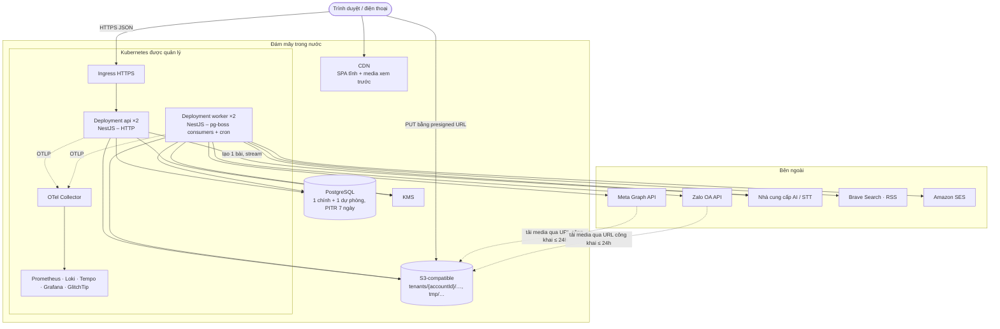
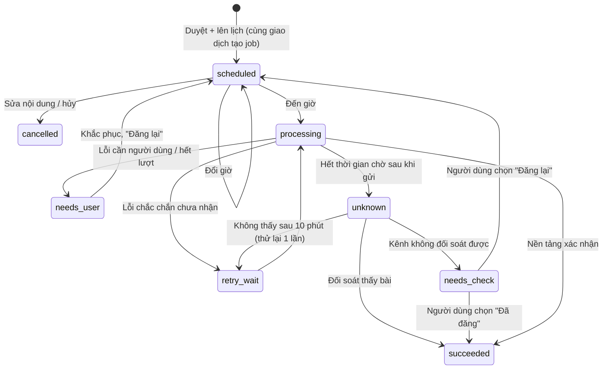

# Đặc tả kiến trúc triển khai – Ứng dụng AI tạo & đăng nội dung MXH

- Phiên bản: 1.4 (2026-11-10) · Trạng thái: tổng hợp từ tài liệu đã duyệt; v1.1 cập nhật theo tính năng
  001 (kho mã nguồn chia module): `platform_gateway` có schema riêng, `approval` có schema dành sẵn;
  v1.2 theo tính năng 002 (lớp CSDL): vai trò `system` đặt được ngữ cảnh tenant và chịu RLS, biểu thức
  RLS dùng `account.current_account_id()`, thêm thuật ngữ lớp CSDL ở mục 11; v1.3 theo tính năng 003
  (lớp hàng chờ): bảng `queue_settings`, `dead_jobs`, `schedule_slots` + schema `pgboss` (mục 4), ghi chú
  hiện thực hàng chờ (mục 6), thuật ngữ hàng chờ (mục 11); v1.4 theo tính năng 004
  (xác thực tối thiểu): chốt T7 (bộ thư viện nhỏ thay khung trọn gói, lý do RLS), lớp chặn quyền ở API
  (mục 5), dữ liệu cá nhân mới, thuật ngữ xác thực ở mục 11
- Nguồn: `TaiLieuDacTa/` – Đặc tả yêu cầu v1.7, ADD tổng thể v1.2, ADD module Worker v1.1 /
  Đăng bài v1.1 / Cổng AI v1.0, ADR-01…10, Kiến trúc dữ liệu & cache v1.2, Lựa chọn công nghệ v1.1
- Vai trò: tài liệu tham chiếu kỹ thuật cho `/speckit-plan`, `/speckit-tasks`, `/speckit-implement`.
  Quy tắc bắt buộc nằm ở `constitution.md`; tài liệu này mô tả **cách triển khai** các quy tắc đó.
  Khi tài liệu gốc thay đổi, cập nhật tài liệu này và tăng phiên bản.
- Quy ước tên: tài liệu gốc dùng tên tiếng Việt; mã nguồn dùng **tên tiếng Anh** theo bảng thuật ngữ
  ở mục 11. Mục nào ghi *(đề xuất)* là chi tiết tài liệu gốc chưa chốt, plan được phép điều chỉnh.

---

## 1. Tổng quan

| Khía cạnh | Quyết định | Nguồn |
|---|---|---|
| Kiểu ứng dụng | Modular monolith, **một mã nguồn → hai đơn vị triển khai: `api` và `worker`**, cùng một ảnh container | ADR-01 |
| Tenant | Chung một PostgreSQL; `account_id` + Row-Level Security trên mọi bảng của khách hàng | ADR-02 |
| Việc nền | Hàng chờ bền vững trong PostgreSQL bằng **pg-boss**; không có hệ thống tin nhắn riêng | ADR-03, T3 |
| Đăng bài | Bộ thực thi 5 bước + phân loại lỗi + đối soát; mỗi nền tảng một bộ chuyển đổi | ADR-04, ADR-05 |
| AI | Mọi lời gọi qua module **AI Gateway**, giữ chỗ ngân sách trước khi gọi | ADR-06 |
| Media | Trình duyệt tải thẳng lên kho S3 bằng đường dẫn ký sẵn; Worker chuẩn hóa và gán nhãn | ADR-07 |
| Cache | Không có cache phân tán; chỉ prompt cache của nhà cung cấp AI, CDN, cache trong tiến trình | ADR-08 |
| Khóa ngoại | Chỉ trong nội bộ module và tới bảng `accounts`; giữa module dùng mã tham chiếu | ADR-09 |
| Hạ tầng | Đám mây trong nước (ưu tiên VNG Cloud), Kubernetes được quản lý | ADR-10, T4, T5 |

Tải giai đoạn 1 nhỏ: khoảng 1.000 lượt đăng/ngày (đỉnh khoảng 5/phút), khoảng 500 lời gọi AI/ngày,
CSDL 3–5 GB/năm, media ≤ 500 GB. Kiến trúc phải chịu được gấp 10 lần bằng cách tăng số bản chạy.
Rủi ro chính đến từ phụ thuộc bên ngoài (Meta App Review, chi phí/chất lượng AI, nguồn xu hướng),
không phải từ tải.

## 2. Ngăn xếp công nghệ

| Lớp | Công nghệ | Trạng thái |
|---|---|---|
| Frontend | React + Vite (TypeScript), SPA, phục vụ tĩnh qua CDN trong nước | Đã chốt |
| Backend | Node.js + TypeScript, **NestJS**, **Drizzle ORM**, **pg-boss** | Đã chốt |
| CSDL | PostgreSQL ≥ 13, RLS. Dùng dịch vụ được quản lý nếu có PITR; nếu không thì **CloudNativePG** trên K8s | Có điều kiện (T4c) |
| Kho tệp | S3-compatible + CDN của cùng nhà cung cấp | Đã chốt |
| Chạy ứng dụng | Kubernetes được quản lý | Đã chốt |
| Bí mật, khóa | KMS của nhà cung cấp (mã hóa token nền tảng) | Đã chốt |
| Giám sát | OpenTelemetry → Prometheus / Loki / Tempo + Grafana; lỗi ứng dụng → **GlitchTip** (Sentry SDK) | Đã chốt |
| Email | Amazon SES qua SMTP | Đã chốt, xem lại theo Q-D3 |
| Xu hướng | RSS báo chính thống + Brave Search API | Đã chốt |
| Xác thực | Bộ thư viện mã nguồn mở nhỏ, bọc trong module `account`: **argon2id** (`@node-rs/argon2`) + **phiên lưu phía máy chủ** (bảng `account.sessions`, mã ngẫu nhiên `node:crypto`, chỉ lưu SHA-256) + **nodemailer** (SMTP); Google/Facebook sau này qua **arctic** (chưa cài). Không dùng khung trọn gói (Better Auth, Auth.js) vì chúng tự truy vấn bảng danh tính ngoài ngữ cảnh tenant – trái RLS/nguyên tắc I (004 research R1) | Đã chốt (004) |
| Mô hình AI, STT | Ứng viên: một mô hình tầm trung và một mô hình nhỏ của Anthropic và OpenAI; STT của OpenAI / FPT.AI / Viettel AI | Chốt sau POC-1, POC-4 |
| Xử lý video | Công cụ dòng lệnh (vd ffmpeg) trong ảnh container của Worker | Đã chốt |

Thư viện quan trọng (pg-boss, SDK AI, SDK nền tảng) phải **cố định phiên bản** và được bọc sau giao
diện nội bộ.

## 3. Hình thái triển khai (Deployment View)

| Thành phần | Số bản (GĐ1) | Ghi chú |
|---|---|---|
| `api` | 2 | Chịu được lỗi một bản. Không xử lý tệp lớn. Tạo **một** bài và tạo lại chạy ngay trong request, trả kết quả dần (stream) |
| `worker` | 2 | Cùng ảnh container với `api`, khác lệnh khởi động. Chạy 6 hàng chờ và bộ hẹn giờ định kỳ |
| PostgreSQL | 1 chính + 1 dự phòng | Sao lưu WAL liên tục + snapshot hằng ngày (giữ 30 ngày); RPO ≤ 5 phút, RTO ≤ 1 giờ; diễn tập khôi phục mỗi quý |
| Kho tệp | Dịch vụ | Bật versioning, tệp đã xóa giữ thêm 7 ngày; `tmp/` tự xóa sau 1 ngày |
| Giám sát | Tự chạy trên cùng cluster | Dữ liệu giám sát ở trong nước |

**Phát hành:**
- `api` và `worker` phát hành cùng nhau từ cùng một ảnh container.
- Thay đổi cấu trúc CSDL (migration) phải tương thích ngược, vì bản cũ và bản mới chạy song song trong
  lúc chuyển. Migration chạy bằng vai trò `owner` và tách khỏi tiến trình ứng dụng.
- Tắt Worker có kiểm soát: ngừng lấy việc mới, chờ việc đang chạy tối đa 30 giây. Việc chưa xong tự
  được trả lại khi khóa hết hạn.

**Cấu hình thay đổi không cần phát hành** (lưu trong CSDL, cache trong tiến trình 5 phút): bảng giá
mô hình, bảng ánh xạ lỗi nền tảng, thông số hàng chờ, danh sách ngành.

## 4. Module và schema

Mỗi module sở hữu một schema PostgreSQL. Module chỉ gọi nhau qua giao diện công khai (NestJS
provider được export). Module không truy cập bảng của module khác. Sự kiện giữa các module được ghi
thành job trong cùng giao dịch. CI tự động kiểm tra phụ thuộc giữa các module.

| Module (mã) | Schema | Bảng chính | Trách nhiệm | FR |
|---|---|---|---|---|
| Account & Plan (`account`) | `account` | `accounts`, `users`, `login_identities`, `memberships`, `subscriptions`, `usage_cycles` | Đăng nhập (mật khẩu/Google/Facebook), vai trò, tenant, chu kỳ theo ngày kích hoạt, hạn mức 100 bài, dung lượng 5 GB, quản trị gói | FR-13, 14, 15 |
| Business Context (`context`) | `context` | `business_profiles`, `profile_versions`, `context_files` | Hồ sơ kinh doanh có phiên bản | FR-01 |
| Media Library (`media`) | `media` | `media`, `media_labels` | Presigned URL, chuẩn hóa, gán nhãn, tìm theo nhãn, không xử lý lại tệp trùng | FR-03 |
| Trends (`trends`) | `trends` | `industries`, `industry_trends`, `account_keywords` | Xu hướng theo ngành hằng tuần (dùng chung); từ khóa riêng + RSS khi tạo kế hoạch | FR-04 |
| Content (`content`) | `content` | `content_plans`, `topics`, `posts`, `channel_variants`, `generations` | Kế hoạch, chủ đề, bài, mỗi kênh một phiên bản, tạo lại ≤ 5 lần; trạng thái duyệt nằm trên `posts` | FR-04, 05, 06 |
| Approval & Schedule (`approval`) | `approval` (dành sẵn, để trống) | — | Thao tác duyệt bài và xếp lịch; chỉ chạy ở API. Thêm bảng vào schema này cần đặc tả mới | FR-06 |
| Publishing (`publishing`) | `publishing` | `publish_attempts`, `publish_steps`, `error_mappings` | Lượt đăng 5 bước, phân loại lỗi, đối soát; module duy nhất được gọi `platform_gateway` | FR-06–10 |
| Platform Gateway (`platform_gateway`) | `platform_gateway` | `channel_connections` | Kết nối kênh, mã quyền truy cập mã hóa (chỉ module này giải mã), bộ chuyển đổi từng nền tảng sau giao diện chung (ADR-05) | FR-02, 07 |
| AI Gateway (`ai_gateway`) | `ai_gateway` | `ai_budgets`, `ai_cost_ledger`, `model_prices` | Điểm duy nhất gọi AI; giữ chỗ/quyết toán ngân sách; chọn mô hình; ghi sổ chi phí | FR-11, 12 |
| Notifications (`notifications`) | `notifications` | `notifications` | Thông báo trong ứng dụng + email, chống gửi lặp, gộp tin trong 10 phút | FR-09 |
| Queue – hạ tầng (`queue`) | `infra` (+ schema thư viện `pgboss`) | `queue_settings`, `dead_jobs`, `schedule_slots`, `audit_log` (+ `pgboss.job_common`, `pgboss.queue` của pg-boss 12.38.0) | Bọc hàng chờ (pg-boss sau giao diện riêng), giới hạn theo tenant, việc hỏng, việc định kỳ, nhật ký kiểm toán | — |

"Duyệt & lịch" (FR-06) có schema `approval` dành sẵn, chưa có bảng: trạng thái duyệt nằm trên
`content.posts`, giờ đăng nằm trên `publishing.publish_attempts`.

Danh sách module, schema, phía chạy (`api`/`worker`) và phụ thuộc được phép nằm trong tệp kê khai
`apps/server/src/modules/modules.manifest.json`; `pnpm check:boundaries` sinh quy tắc từ tệp này.

*(đề xuất)* Bố cục mã nguồn: một workspace gồm `apps/web` (React), `apps/server` (NestJS; hai lệnh khởi
động `api` và `worker`) và `packages/shared` (kiểu dữ liệu, DTO dùng chung giữa web và server). Mỗi
module nằm trong `apps/server/src/modules/<module>/` và chỉ export giao diện công khai qua `index.ts`.

## 5. Tenant xuyên suốt

| Điểm | Cách triển khai |
|---|---|
| API | `accountId` lấy từ phiên đăng nhập, gắn vào request context. **Không** nhận từ param/body/path |
| CSDL | Mỗi giao dịch chạy `set_config('app.account_id', $1, true)` (phạm vi giao dịch). Chính sách RLS `tenant_isolation`: `account_id = account.current_account_id()` – hàm `nullif(current_setting('app.account_id', true), '')::uuid` vì sau giao dịch biến thành chuỗi rỗng; thiếu biến thì không thấy dòng nào. Module chỉ truy cập CSDL qua `tenantTx` / `systemTx` / `supportSearch` / `supportViewAccount` (`core/db`) |
| Vai trò CSDL | `owner` (chỉ migration) · `app` (API/Worker, chịu RLS, không có BYPASSRLS) · `system` (chỉ Worker – job dùng chung; ghi schema dùng chung; đặt được ngữ cảnh tenant của **một** tài khoản cho việc theo tài khoản và khi đó chịu cùng RLS `tenant_isolation` – Clarifications 002; khuyến nghị ghi bộ đếm qua hàm `SECURITY DEFINER`) · `support` (chỉ đọc view đã lọc, không có cột bí mật; mọi truy vấn ghi audit) |
| Hàng chờ | Dữ liệu job chỉ chứa mã tham chiếu và `accountId`; Worker đặt lại ngữ cảnh tenant trước khi gọi bộ xử lý. Có giới hạn đồng thời theo tenant |
| Kho tệp | `tenants/{accountId}/media/{mediaId}/original` · `/normalized/…` · `/thumb` · `tenants/{accountId}/context/…` · `tmp/{jobId}/…` |
| Nhật ký, chỉ số | Gắn `account_id`, `trace_id`; **không** ghi token, nội dung bài, prompt |
| Prompt cache AI | Phân theo tenant; không đưa hồ sơ của nhiều tài khoản vào cùng phần đầu prompt |

**Xác thực và chặn quyền ở API (004).** `AccessGuard` toàn cục, **mặc định từ chối**: mỗi điểm cuối phải có
đúng một khai báo `@Public` / `@CustomerAccess(...quyền)` / `@StaffAccess(...quyền)` (thiếu → 403
`ACCESS_NOT_DECLARED`, dev/test không khởi động được). Guard đọc cookie `__Host-sid` (khách) hoặc
`__Host-staff_sid` (nhân viên), tra phiên qua bộ nhớ đệm trong tiến trình ≤ 60 giây rồi qua
`SessionResolver`, gắn `actor` và `accountId` vào ngữ cảnh – guard là nơi **duy nhất** gọi
`bindAccountToRequest`, không đọc path/query/body. Danh mục quyền là dữ liệu dùng chung
(`packages/shared/src/auth/permissions.ts`). Các bước trước khi biết tenant (đăng ký, tra email, tra
phiên, tra mã một lần) đi qua 4 hàm `SECURITY DEFINER` hẹp (`account.auth_register`,
`auth_lookup_email`, `auth_resolve_session`, `auth_find_token`, chỉ `app` được gọi) trong `authTx`
(giao dịch `app` không tenant, bộ gác vẫn chặn bảng tenant); sau khi danh tính đã xác minh thì
`runInAccountScope(accountId)` + `tenantTx`. Hai hàm hạn chế này có quy tắc ranh giới riêng
(`auth-tx-restricted`, `account-scope-restricted`). Chống giả mạo yêu cầu: kiểm `Origin`/`Sec-Fetch-Site`
cho mọi phương thức không an toàn + `SameSite=Lax`. Chống dò: bộ đếm nguyên tử `account.auth_throttle`
(khóa HMAC). Hướng dẫn: `apps/server/docs/auth.md`.

Bắt buộc trong CI: (1) kiểm thử truy cập chéo trên mọi bảng (tài khoản A thử đọc/sửa/xóa dữ liệu của
B, phải thất bại); (2) lint phát hiện bảng có `account_id` mà chưa bật RLS.

## 6. Worker và hàng chờ

| Queue | Việc | Đồng thời/bản | Tối đa/tenant | Thời gian khóa | Thử lại |
|---|---|---|---|---|---|
| `publish` | Thực hiện lượt đăng, đối soát | 10 | 3 | 2 phút | Theo ADR-04 (≤ 5 lần / 30 phút; không xác định → đối soát) |
| `media` | Chuẩn hóa ảnh; video: lấy 8 khung hình, tách âm thanh 5 phút đầu, phát hiện giọng nói cục bộ; gán nhãn | 2 | 1 | 15 phút | 3 lần: 1 → 5 → 15 phút |
| `ai_batch` | Đề xuất chủ đề; tạo bài hàng loạt (mỗi chủ đề một job con) | 5 | 3 | 3 phút | 2 lần; hết ngân sách → không thử lại |
| `trends` | Thu thập/tóm tắt theo ngành; từ khóa riêng | 2 | 1 | 10 phút | 3 lần: 1 → 4 giờ |
| `notify` | Email, thông báo trong ứng dụng | 5 | — | 1 phút | 5 lần, giãn cách tăng dần |
| `scheduled` | Các việc định kỳ bên dưới | 2 | — | 10 phút | Lần chạy kế tiếp tự bù |

Các con số là giả định ban đầu, cấu hình được. Mọi bộ xử lý phải **chạy lại được an toàn**:

| Việc | Cách bảo đảm |
|---|---|
| Đăng bài | Trạng thái "đã gửi, chờ phản hồi" + đối soát |
| Media | Ghi đè theo `mediaId`; đã có kết quả cho cùng dấu tệp thì bỏ qua |
| Tạo bài hàng loạt | Mỗi job gắn một chủ đề; chủ đề đã có bài thì bỏ qua |
| Lời gọi AI | Giữ chỗ treo được việc định kỳ trả lại |
| Email | Khóa chống trùng theo mã thông báo |

Job hỏng hẳn được chuyển sang `dead_jobs` kèm lỗi cuối; hỗ trợ chạy lại được bằng một thao tác.
Khóa chống trùng (singleton key) có dạng `publish:{attemptId}`, `media_label:{mediaId}`,
`scheduled:{name}:{slot}`.

**Ghi chú hiện thực (003):** 6 hàng chờ pg-boss chính sách `exclusive` (khóa chống trùng duy nhất trong số
việc chờ · chờ thử lại · đang chạy; mọi việc luôn có khóa, mặc định `{loại việc}:{mã việc}`). Dữ liệu việc là
phong bì `{ type, v, accountId, traceId, payload }`, `group_id` = mã tài khoản – dùng cho cả giới hạn tenant
lẫn RLS trên `pgboss.job_common` (`app` chỉ thấy việc của tenant hiện hành). Khóa việc = heartbeat 30 giây
(gia hạn mỗi 10 giây) + trần cứng "thời gian khóa" ở bảng trên. Worker không dùng `work()`: mỗi hàng chờ
một vòng lấy việc trên bể điều khiển (vai trò `system`), lệnh lấy việc chạy dưới
`pg_advisory_xact_lock(hashtext('queue_fetch:' || hàng chờ))` để giới hạn tenant không bị vượt khi nhiều bản
lấy cùng lúc. Thông số ở `infra.queue_settings` (đọc lại mỗi 60 giây). Việc hỏng ở `infra.dead_jobs` (không
dùng `deadLetter` của thư viện). Việc định kỳ: bộ hẹn giờ riêng trên mọi bản, khóa khung bằng PK
`(name, slot)` của `infra.schedule_slots`, chống chồng bằng khóa `scheduled:{name}` – không dùng
`schedule()` của pg-boss. Tài liệu cho lập trình viên module: `apps/server/docs/queue.md`.

**Việc định kỳ** (chạy trên mọi bản Worker, chống trùng theo khung thời gian):

| Việc | Tần suất |
|---|---|
| Mở chu kỳ mới (ngân sách AI + hạn mức bài) | Mỗi giờ |
| Kiểm tra gói hết hạn | Mỗi giờ |
| Làm mới token kênh; còn < 7 ngày mà không làm mới được → nhắc người dùng | Hằng ngày |
| Thu thập xu hướng theo ngành | Thứ Hai 05:00 (UTC+7) |
| Chia đều chi phí xu hướng cho các tài khoản cùng ngành | Sau mỗi lần thu thập |
| Trả lại giữ chỗ ngân sách treo quá 15 phút | Mỗi 10 phút |
| Đối soát sổ chi phí AI với nhà cung cấp (lệch > 5% → cảnh báo) | Hằng ngày |
| Xóa tài khoản (hết hạn > 90 ngày, báo trước 7 ngày; hoặc theo yêu cầu, xóa xong ≤ 30 ngày) | Hằng ngày |
| Dọn dẹp (job xong > 30 ngày, job chết > 90 ngày, tệp tạm, bản ghi tải lên dở > 1 giờ, tệp mồ côi) | Hằng ngày / hằng tuần |
| Tạo trước phân vùng tháng; bỏ phân vùng > 12 tháng | Hằng tháng |
| Phát hiện lượt đăng quá giờ > 5 phút | Mỗi phút |
| Báo cáo tham chiếu giữa module bị hỏng | Hằng ngày |

## 7. Luồng trọng yếu

### 7.1 Đăng bài (Publishing)

- Chỉ mục duy nhất `(post_id, channel_connection_id) WHERE status <> 'cancelled'` trên
  `publish_attempts`. Mọi chuyển trạng thái dùng `UPDATE … WHERE status = :expected`.
- Năm bước được ghi vào `publish_steps` (chỉ thêm, phân vùng theo tháng): `precheck` →
  `prepare_media` → `submit` → `await_processing` → `confirm`. Trước khi gọi nền tảng phải ghi
  `submitted_awaiting_response` + `content_hash`.
- Đổi giờ: chỉ khi mọi lượt đăng của bài còn ở `scheduled`. Giờ đăng và thời điểm chạy của job được
  cập nhật trong cùng giao dịch; kiểm tra lại hạn mức kênh ở giờ mới; không phải duyệt lại.
- Giao diện bộ chuyển đổi nền tảng (`PlatformAdapter`): `checkAccount`, `mediaRules`, `submit`,
  `checkStatus`, `reconcile`, `classifyError`, `refreshToken`. Bộ chuyển đổi giai đoạn 1: Facebook
  Page, Instagram, Zalo OA. TikTok thêm sau.
- Mỗi lỗi được phân thành `transient` | `user_action` | `unknown`. Bảng `error_mappings` (cấu hình)
  chứa thông điệp tiếng Việt và cách khắc phục.
- Token nền tảng được mã hóa bằng KMS và chỉ giải mã trong adapter. Media được đưa cho nền tảng qua
  URL công khai có hạn ≤ 24 giờ.

### 7.2 Lời gọi AI (AI Gateway)

1. Ước tính chi phí tối đa = token đầu vào (đếm trước) × giá + `max_output_tokens` × giá, theo giá
   của mô hình dự kiến dùng.
2. Giữ chỗ:
   `UPDATE ai_budgets SET reserved = reserved + :est WHERE … AND used + reserved + :est <= cap`.
   Không có dòng nào được cập nhật → chặn với thông báo "Đã sử dụng hết giới hạn AI của chu kỳ".
   Ràng buộc `CHECK (used + reserved <= cap)` là chốt chặn cuối.
3. Chọn mô hình: `used + reserved < soft_limit` (2.000.000 micro-USD) → mô hình mặc định; ngược lại
   → mô hình rẻ. Gán nhãn và tóm tắt xu hướng luôn dùng mô hình rẻ.
4. Gọi nhà cung cấp, rồi quyết toán (`used += actual`, `reserved -= est`) và ghi `ai_cost_ledger`
   (tài khoản, chu kỳ, loại việc, mô hình, token vào/ra/cache, chi phí, `trace_id`). Lỗi hoặc hết
   thời gian → trả lại giữ chỗ, thử nhà cung cấp dự phòng 1 lần.
5. Mức sử dụng hiển thị cho khách = `floor((used + reserved) / cap × 100)%`. Đạt 80% → thông báo
   trong ứng dụng + email, mỗi chu kỳ một lần. Không bao giờ hiển thị số tiền.

Thứ tự prompt cố định để tận dụng prompt cache: chỉ dẫn hệ thống → hồ sơ kinh doanh (theo phiên bản)
→ xu hướng ngành của tuần → phần thay đổi. STT ước tính chi phí tối đa theo
`min(thời lượng, 5 phút) × giá/phút`.

### 7.3 Media

API kiểm tra dung lượng còn lại và giữ chỗ dung lượng, cấp presigned PUT URL (≤ 15 phút) và tạo bản
ghi `uploading`. Trình duyệt tải tệp lên. API xác nhận (tệp tồn tại, kích thước, hash) và chuyển bản
ghi sang `ready`, đồng thời tạo job `media`. Nếu đã có hash trùng trong cùng tài khoản thì sao chép
kết quả cũ, không tốn AI. Media dùng được ngay sau khi chuẩn hóa, kể cả khi gán nhãn lỗi hoặc hết
ngân sách. Xóa media: đánh dấu xóa trước, job nền xóa tệp sau. Media đang được bài đã lên lịch dùng
thì không xóa hẳn được.

### 7.4 Kế hoạch và tạo bài hàng loạt

Tạo kế hoạch → job đề xuất chủ đề → người dùng chọn chủ đề → mỗi chủ đề một job con trong `ai_batch`
(≤ 3 job đồng thời/tenant). Hạn mức bài được kiểm tra khi tạo job con và chỉ bị trừ khi bài tạo thành
công. Hết ngân sách → chủ đề còn lại chuyển "Chưa tạo – hết giới hạn AI", hủy các job con còn lại.
Giao diện hỏi định kỳ để cập nhật tiến độ.

## 8. Quy ước dữ liệu

| Quy ước | Quyết định |
|---|---|
| Khóa chính | UUID v7 sinh ở ứng dụng |
| Thời gian | `timestamptz` lưu UTC; hiển thị UTC+7 |
| Tiền | `bigint` micro-USD (4 USD = 4.000.000) |
| Cột bắt buộc trên bảng của khách hàng | `account_id NOT NULL` (cột đầu của mọi chỉ mục), `created_at`, `updated_at` |
| Xóa | Bảng nghiệp vụ: xóa mềm (`deleted_at`) 30 ngày rồi xóa hẳn; bảng nhật ký: chỉ bỏ cả phân vùng |
| Khóa lạc quan | Cột `version` trên `posts` và `channel_variants`; lệch phiên bản → "Bài vừa được người khác sửa" |
| Bộ đếm | `usage_cycles.posts_used` có `CHECK (posts_used <= posts_limit)`; dung lượng giữ chỗ khi cấp URL, trả lại sau 1 giờ nếu tải bỏ dở |
| Phân vùng theo tháng | Chỉ `publish_steps`, `ai_cost_ledger`, `audit_log` (giữ 12 tháng) |
| Chu kỳ | Theo ngày kích hoạt gói, lặp hằng tháng; tháng không có ngày đó → ngày cuối tháng |
| Không phân mảnh CSDL | Xem lại khi > 10.000 tài khoản hoặc CSDL > 1 TB |

**Cấm cache:** ngân sách AI, hạn mức, dung lượng, trạng thái lượt đăng, token nền tảng đã giải mã.
**Được cache:** prompt cache của nhà cung cấp AI; CDN (SPA cache 1 năm theo hash tên tệp, media xem
trước ≤ 1 giờ); kết quả tính sẵn trong CSDL (xu hướng theo tuần, nhãn theo hash); cache trong tiến
trình cho cấu hình (5 phút) và phiên + vai trò (60 giây). Giới hạn tốc độ đếm trong bộ nhớ của từng bản
API (vd 60 yêu cầu/phút/tài khoản).

**Dữ liệu cá nhân của xác thực (004, data-model.md mục 8)** – bổ sung danh mục ở Kiến trúc dữ liệu mục 9:
email, tên hiển thị (`users`, `staff_users`); băm mật khẩu argon2id (`login_identities`, `staff_users` – không
bao giờ rời CSDL); tóm tắt thiết bị "Chrome · Android" ≤ 60 ký tự (`sessions`); địa chỉ mạng trong
`infra.audit_log.metadata` (12 tháng theo phân vùng, ẩn danh hóa khi xóa tài khoản); email/địa chỉ mạng
ở `auth_throttle` **chỉ dạng HMAC** (≤ 24 giờ). Metadata kiểm toán chỉ có `{ ip, ua_family, reason }`, không
email, mật khẩu hay mã. Không có bên nhận mới ở nước ngoài (SES đã có).

## 9. Quan sát và cảnh báo

- Mỗi lượt đăng có `trace_id` đi qua API → job → Worker → nền tảng (OpenTelemetry).
- Nhật ký có cấu trúc gồm `trace_id`, `account_id`, loại job, lần thử, thời gian, kết quả.
- Nhật ký nghiệp vụ (5 bước) tách khỏi nhật ký kỹ thuật.

| Cảnh báo | Ngưỡng |
|---|---|
| Tỷ lệ lỗi đăng một kênh | > 5% / 15 phút |
| Tuổi job chờ lâu nhất | `publish` > 5 phút · `media` > 10 phút · `notify` > 5 phút |
| `dead_jobs` | `publish` > 0 → cảnh báo ngay · loại khác > 10/ngày |
| p95 xử lý video | > 8 phút |
| Số bản Worker đang sống | < 2 |
| Tài khoản chạm ngưỡng 2 USD | > 5% trong chu kỳ |
| Sổ chi phí AI lệch hóa đơn | > 5% |
| Tỷ lệ lỗi nhà cung cấp AI | > 5% / 15 phút |
| Tỷ lệ "Cần kiểm tra" | > 1% lượt đăng (điều kiện xem lại ADR-04) |

## 10. Mục tiêu phi chức năng phải kiểm chứng

| Nhóm | Mục tiêu |
|---|---|
| Hiệu năng | Tạo 1 bài (mọi kênh) p95 ≤ 45 giây, chữ đầu tiên hiện ≤ 5 giây · 10 chủ đề ≤ 60 giây · gán nhãn ảnh ≤ 1 phút, video ≤ 10 phút · kiểm tra ngân sách ≤ 50 ms · trang đầu ≤ 3 giây trên 4G |
| Tin cậy | ≥ 98% đăng thành công · lệch lịch ≤ 5 phút · 0 bài trùng · không mất job khi khởi động lại |
| Khả dụng | 99,5%/tháng · RPO ≤ 5 phút · RTO ≤ 1 giờ |
| Mở rộng | Gấp 10 lần (30.000 lượt đăng/tháng, 500 GB) mà không đổi kiến trúc |
| Bảo mật | Cô lập tenant · token mã hóa, không xuất hiện trong log · nhật ký duyệt/đăng giữ 12 tháng |

## 11. Bảng thuật ngữ Việt → Anh (dùng cho mã nguồn)

| Tài liệu gốc | Mã nguồn | Tài liệu gốc | Mã nguồn |
|---|---|---|---|
| tai_khoan / tai_khoan_id | account / `account_id` | ke_hoach | `content_plans` |
| nguoi_dung | `users` | chu_de | `topics` |
| lien_ket_dang_nhap | `login_identities` | bai | `posts` |
| thanh_vien | `memberships` | phien_ban_kenh | `channel_variants` |
| goi_dich_vu | `subscriptions` | lan_tao | `generations` |
| chu_ky_su_dung | `usage_cycles` | ket_noi_kenh | `channel_connections` |
| ho_so_kinh_doanh | `business_profiles` | luot_dang | `publish_attempts` |
| phien_ban_ho_so | `profile_versions` | buoc_dang | `publish_steps` |
| tep_ngu_canh | `context_files` | anh_xa_loi | `error_mappings` |
| media / nhan_media | `media` / `media_labels` | ngan_sach_ai | `ai_budgets` |
| nganh | `industries` | so_chi_phi_ai | `ai_cost_ledger` |
| xu_huong_nganh | `industry_trends` | bang_gia_mo_hinh | `model_prices` |
| tu_khoa_tai_khoan | `account_keywords` | thong_bao | `notifications` |
| viec / viec_chet | pg-boss job / `dead_jobs` | nhat_ky_kiem_toan | `audit_log` |
| da_dung / da_giu / tran / nguong_mem | `used` / `reserved` / `cap` / `soft_limit` | dau_tep / dau_noi_dung | `file_hash` / `content_hash` |
| ma_theo_doi | `trace_id` | da_xoa_luc / tao_luc / cap_nhat_luc / phien_ban | `deleted_at` / `created_at` / `updated_at` / `version` |
| Hàng chờ dang_bai / media / ai_hang_loat / xu_huong / thong_bao / dinh_ky | `publish` / `media` / `ai_batch` / `trends` / `notify` / `scheduled` | Vai trò CSDL chu_so_huu / ung_dung / he_thong / ho_tro | `owner` / `app` / `system` / `support` |
| Chủ tài khoản / Cộng tác viên / Hỗ trợ / Quản trị nội bộ | `owner` / `collaborator` / `support` / `admin` | Nháp / Chờ duyệt / Đã duyệt | `draft` / `pending_review` / `approved` |

| Duyệt & lịch (module) | `approval` (schema `approval` dành sẵn) | Cổng nền tảng (module) | `platform_gateway` (schema `platform_gateway`) |
| Hàng chờ (module hạ tầng) | `queue` (schema `infra`) | Lõi dùng chung phía máy chủ | `core` (`apps/server/src/core`) |
| Tệp kê khai module | `modules.manifest.json` | Đơn vị triển khai | `api` / `worker` |

| Biến phiên tenant | GUC `app.account_id`; hàm `account.current_account_id()` | Khuôn chính sách mẫu | chính sách `tenant_isolation` |
| Bảng khách hàng / dùng chung / nhật ký phân vùng | loại `tenant` / `shared` / `partitioned_log`; `tenantTable` / `sharedTable` / `partitionedLogTable` | Giao dịch có ngữ cảnh tenant / hệ thống / hỗ trợ | `tenantTx` / `systemTx` / `supportSearch`, `supportViewAccount` |
| Bảng mẫu (chỉ dev/test) | schema `sandbox`: `tenant_notes`, `support_note_search`, `support_note_detail` | Nhật ký migration | `infra.schema_migrations`, `infra.schema_migrations_dev` |
| Xung đột phiên bản | mã lỗi `VERSION_CONFLICT` | Kiểm tra quy ước CSDL | `pnpm db:check` |

| Phiên đăng nhập | `account.sessions`, cookie `__Host-sid` | Nhân viên nội bộ / phiên nhân viên | `account.staff_users` / `account.staff_sessions`, cookie `__Host-staff_sid` |
| Mã một lần (xác minh email, đặt lại mật khẩu) | `account.auth_tokens` (`purpose`: `verify_email`, `reset_password`) | Bộ đếm chống dò | `account.auth_throttle` |
| Ghế thành viên | `memberships.seat` | Danh mục quyền | `PERMISSIONS`, kiểu `Permission` (`@app/shared/auth`) |
| Người gọi | `actor` trong `ExecutionContext`; `currentActor()`, `can()` | Khai báo truy cập điểm cuối | `@Public`, `@CustomerAccess`, `@StaffAccess`; `AccessGuard` |
| Giao dịch xác thực không tenant | `authTx` | Chạy trong phạm vi tài khoản đã xác minh | `runInAccountScope` |
| Giao diện gửi thư | `core/mail`, `Mailer`, `MAILER` | Lệnh vận hành nhân viên / dữ liệu mẫu | `pnpm staff` / `pnpm dev:seed-auth` |
| loại việc | `job type` – `JobTypeDefinition`, tên `<module>.<action>` (`defineJobType`) | việc tenant / việc hệ thống | `tenant job` / `system job` (`scope`: `'tenant'` / `'system'`) |
| khóa chống trùng | `dedupeKey` (API) → `singleton_key` (pg-boss) | giờ chạy sớm nhất | `runAfter` (API) → `start_after` (pg-boss) |
| thời gian khóa / nhịp gia hạn | `lock_seconds` → `expireInSeconds` / `heartbeat_seconds` | khung thời gian | `slot` (`infra.schedule_slots`) |
| việc định kỳ | `schedule` (`defineSchedule`) | cấu hình hàng chờ | `infra.queue_settings` |
| việc hỏng / chôn việc | `infra.dead_jobs` / `buryJob` | chạy lại việc hỏng | `retry dead job` (`requestDeadJobRetry`) |
| bể điều khiển hàng chờ | `queue control pool` (vai trò `system`, chỉ Worker) | phong bì việc | `job envelope` |
| schema thư viện hàng chờ | `pgboss` | bộ chạy hàng chờ của một bản Worker | `QueueRuntime` |

Thuật ngữ mới phải được thêm vào bảng này trong cùng thay đổi (cùng PR).

## 12. Việc còn mở ảnh hưởng triển khai

| Mã | Nội dung | Ảnh hưởng tới mã nguồn | Mốc |
|---|---|---|---|
| T4 | Chốt nhà cung cấp đám mây sau 3 điểm xác minh: PITR, giá băng thông ra, SLA ≥ 99,5% | Chỉ ảnh hưởng cấu hình (chuẩn mở) | Trước khi ký hợp đồng |
| T4c | CSDL được quản lý hay CloudNativePG | Chỉ ảnh hưởng hạ tầng | Theo T4 |
| ~~T7~~ | ~~Chọn thư viện xác thực cụ thể~~ – **đã chốt ở 004**: argon2 + phiên máy chủ + arctic (sau), xem mục 2 | Module `account` | Xong (2026-11-10) |
| T11 | Mô hình AI, dịch vụ STT | Chỉ ảnh hưởng adapter nhà cung cấp trong AI Gateway | POC-1, POC-4 |
| POC-2 | Khả năng đối soát của từng nền tảng; hạn mức Zalo OA/Instagram; thời gian khóa 2 phút cho video | Adapter + `error_mappings` | Trước khi hoàn thiện Publishing |
| POC-3 | Chất lượng nguồn xu hướng | Module `trends` | Trước khi hoàn thiện Trends |
| Q-D3/C6 | Hồ sơ đánh giá tác động chuyển dữ liệu xuyên biên giới | Màn hình đồng ý, giảm thiểu dữ liệu gửi đi | **Trước ngày ra mắt** |
| Meta App Review | Cần bản chạy được luồng kết nối + đăng bài | Ưu tiên làm tính năng này đầu tiên | Càng sớm càng tốt |

## 13. Checklist kiến trúc cho mỗi `plan.md`

- [ ] Tính năng thuộc module nào; chỉ chạm schema của module đó; mọi lời gọi sang module khác đi qua
      giao diện công khai.
- [ ] Bảng mới có `account_id`, RLS, kiểm thử truy cập chéo; tên đúng bảng thuật ngữ mục 11.
- [ ] Việc chạy lâu hoặc cần tin cậy đi qua queue đúng loại; bộ xử lý chạy lại được an toàn; job
      được tạo trong cùng giao dịch với dữ liệu nghiệp vụ.
- [ ] Mọi lời gọi AI đi qua AI Gateway; giao diện chỉ hiển thị %.
- [ ] Bộ đếm và chuyển trạng thái dùng cập nhật có điều kiện, có ràng buộc CSDL làm chốt chặn cuối.
- [ ] Không thêm hạ tầng mới (cache, broker, dịch vụ) khi chưa có ADR.
- [ ] Có `trace_id`, log có cấu trúc, không log bí mật; có chỉ số/cảnh báo nếu tính năng có SLO.
- [ ] Migration tương thích ngược.
