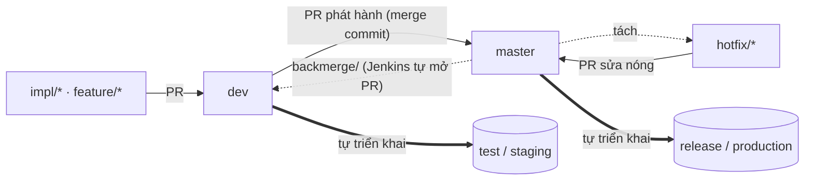

# Luồng nhánh và phát hành

Mục tiêu: người mới đọc tài liệu này (và [gates.md](gates.md)) là đưa được một thay đổi nhỏ lên môi trường test
trong ngày đầu, không cần ai làm hộ bước nào (SC-013).

| Nhánh                 | Vai trò                                     | Triển khai lên         |
| --------------------- | ------------------------------------------- | ---------------------- |
| `dev`                 | mã đã review, đang chờ phát hành            | `staging` (test)       |
| `master`              | mã đã phát hành                             | `production` (release) |
| `impl/*`, `feature/*` | làm việc, luôn đi qua pull request          | —                      |
| `hotfix/*`            | sửa nóng, tách từ `master`                  | qua `master`           |
| `backmerge/*`         | Jenkins tự tạo để đưa bản sửa nóng về `dev` | —                      |

**Không ai đẩy thẳng vào `dev` hoặc `master`** (FR-004): mọi thay đổi qua pull request, kiểm tra bắt buộc duy nhất là
`ci/gates`. Luật bảo vệ nhánh nằm ở `ops/ci/github/rulesets/` và được áp bằng `ops/ci/github/apply-rulesets.sh`.

> **Trạng thái hiện tại**: kho đang ở gói GitHub miễn phí, kho riêng tư **không** cho áp ruleset. Trong lúc đó luật
> chỉ tồn tại dưới dạng tệp (và `pnpm check:pipeline` vẫn kiểm chúng hợp lệ); người duy nhất có quyền ghi là chủ dự án
> và quy tắc "không đẩy thẳng" dựa vào kỷ luật. Khi nâng gói (hoặc chuyển kho sang tổ chức) chạy `apply-rulesets.sh`.

## 1. Thay đổi thường (đi lên `dev`, rồi `master`)

1. Tách nhánh từ `dev`: `git switch -c impl/<mã-tính-năng> origin/dev`.
2. Kiểm tra ở máy mình trước: `pnpm verify` (xem [gates.md](gates.md)). Kết quả trên Jenkins giống hệt (SC-012).
3. Mở pull request vào `dev`. Jenkins chạy `ci/gates` (≤ 15 phút) và đăng từng `gate/<bước>`.
4. Khi `ci/gates` xanh (và có người duyệt nếu kho từ hai thành viên) thì hợp nhất. `deploy/staging/deploy` tự chạy:
   cổng → ảnh → migration → rollout → web → kiểm tra khói → thông báo Telegram.
5. Phát hành: mở pull request `dev` → `master`, hợp nhất bằng **merge commit** (cách duy nhất `master` cho phép). Cổng
   `check:release-source` chỉ đạt khi đầu pull request **đã triển khai thành công lên test**; Jenkins tự chạy lại
   `ci/gates` ngay sau khi test xanh nên không ai phải bấm. Chỉ người có vai `release-manager` hợp nhất vào `master`.
6. `deploy/production/deploy` tự chạy cùng các bước. Không có bước chờ xác nhận.

## 2. Sửa nóng

1. `git switch -c hotfix/<mô-tả> origin/master` – nhánh chỉ mang bản sửa, **không** mang commit nào của `dev`.
2. Pull request vào `master`. `check:release-source` kiểm mọi commit trong `master..đầu PR` không thuộc `dev`.
3. Sau khi hợp nhất và `production` qua kiểm tra khói, Jenkins tạo nhánh `backmerge/<sha12>` và mở pull request đưa về
   `dev` (≤ 10 phút), báo số pull request trên Telegram. Có xung đột → pull request vẫn mở, gắn nhãn
   `needs-manual-merge`. Phải hợp nhất pull request này **trước** khi phát hành thường kế tiếp (nếu không
   `check:release-source` chặn: "Bản sửa nóng … chưa về dev").
4. **Bản sửa nóng không được kèm migration** (xem [backward-compatible-migrations.md](backward-compatible-migrations.md):
   migration có mốc thời gian cũ hơn bị bỏ qua âm thầm). Cần đổi cấu trúc CSDL thì đi đường thường.

## 3. Xem môi trường đang chạy bản nào (FR-045)

Trang **Environments** của kho trên GitHub (Code → Environments → `staging` / `production`) liệt kê từng lần triển
khai: commit, thời điểm, kết quả. Bấm vào một lần triển khai để xem bản ghi `DeploymentRecord` (ai hợp nhất, ai duyệt,
digest ảnh, migration đã áp, các cổng đã dùng ngoại lệ, đã quay về hay chưa). Mọi môi trường có đúng một lần
triển khai "thành công gần nhất" – đó là bản đang chạy.

## 4. Khi có điều gì đó đỏ

| Dấu hiệu                               | Làm gì                                                                                           |
| -------------------------------------- | ------------------------------------------------------------------------------------------------ |
| `gate/<bước>` đỏ trên pull request     | đọc tên cổng · dòng lỗi đầu · liên kết nhật ký · lệnh chạy lại; chạy lại đúng lệnh đó ở máy mình |
| `ci/gates` đỏ vì hạ tầng chập chờn     | bấm **Re-run** (không có tự chạy lại); lặp lại vẫn đỏ thì xem [gates.md](gates.md)               |
| Cần vượt một cổng đỏ vì lý do tạm thời | [gate-exceptions.md](gate-exceptions.md) (không áp dụng cho cổng an toàn dữ liệu)                |
| Triển khai báo "ĐÃ QUAY VỀ BẢN TRƯỚC"  | môi trường vẫn chạy bản cũ; sửa lỗi rồi hợp nhất lại, hoặc xem [rollback.md](rollback.md)        |
| Jenkins ngừng hoạt động                | [emergency-deploy.md](emergency-deploy.md)                                                       |

## Lịch sử diễn tập (SC-013)

| Ngày        | Người làm | Thời gian từ đầu tới lên test | Câu hỏi phát sinh / điều đã sửa trong tài liệu |
| ----------- | --------- | ----------------------------- | ---------------------------------------------- |
| _(chưa có)_ |           |                               |                                                |
