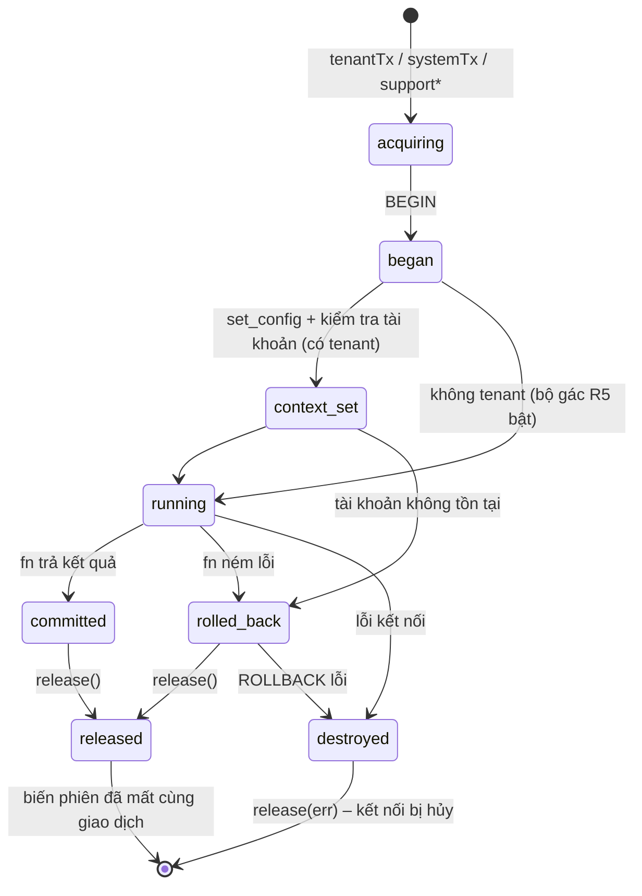

# Data Model – Lớp CSDL, ngữ cảnh tenant, RLS mẫu (002)

Phase 1. Tên định danh tiếng Anh theo `architecture.md` mục 11 và bảng thuật ngữ mới ở `research.md`.
Kiểu PostgreSQL ghi theo DDL; định nghĩa Drizzle tương ứng do tasks viết.

## 1. Schema theo module

Danh sách lấy từ `apps/server/src/modules/modules.manifest.json` (trường `schema`). Migration đầu tiên
tạo schema cho **mọi** mục trong tệp kê khai; kiểm thử so tập schema thực tế với tệp kê khai.

| Module | Schema | Loại | Đối tượng tạo trong tính năng này |
|---|---|---|---|
| `account` | `account` | nghiệp vụ | bảng `accounts`; hàm `current_account_id()` |
| `context` | `context` | nghiệp vụ | — |
| `media` | `media` | nghiệp vụ | — |
| `trends` | `trends` | nghiệp vụ | — |
| `content` | `content` | nghiệp vụ | — |
| `approval` | `approval` | dành sẵn (`reservedSchema`) | — (không cấp quyền mặc định) |
| `publishing` | `publishing` | nghiệp vụ | — |
| `platform_gateway` | `platform_gateway` | cổng | — |
| `ai_gateway` | `ai_gateway` | cổng | — |
| `notifications` | `notifications` | nghiệp vụ | — |
| `queue` | `infra` | hạ tầng | `audit_log` (phân vùng), `schema_migrations`, hàm `ensure_audit_log_partitions()` |
| — (chỉ dev/test) | `sandbox` | kiểm thử | `tenant_notes`, `support_note_search`, `support_note_detail` |

Chủ sở hữu mọi schema và đối tượng: `owner`. Schema `public` không dùng (đã thu hồi `CREATE`).
`infra.schema_migrations[_dev]` do trình migrate tạo; chỉ `owner` có quyền.

## 2. Vai trò CSDL và quyền

Tạo bởi bootstrap (R6). Tất cả `LOGIN NOSUPERUSER NOBYPASSRLS NOCREATEDB NOCREATEROLE NOREPLICATION`,
không là thành viên của vai trò nào.

| Vai trò | Dùng bởi | Schema nghiệp vụ/cổng (bảng `tenant`) | Bảng `shared` | `infra.audit_log` | Khung nhìn hỗ trợ | Đổi cấu trúc |
|---|---|---|---|---|---|---|
| `owner` | `db:migrate` | chủ sở hữu | chủ sở hữu | chủ sở hữu | chủ sở hữu | có |
| `app` | API, Worker (việc của tenant) | `SELECT, INSERT, UPDATE, DELETE` + RLS | mặc định như cột trái; bảng chỉ đọc tự `REVOKE` trong migration của nó | `INSERT` | không | không |
| `system` | Worker (việc dùng chung) | như `app` + RLS (Clarifications) | `SELECT, INSERT, UPDATE, DELETE` | `INSERT`; `EXECUTE ensure_audit_log_partitions` | không | không |
| `support` | API – tra cứu hỗ trợ | **không** | không | `INSERT` | `SELECT` | không |

Cơ chế cấp:

```text
GRANT USAGE ON SCHEMA <s> TO app, system           -- mọi schema nghiệp vụ/cổng, trừ approval
GRANT USAGE ON SCHEMA infra, sandbox TO support    -- sandbox chỉ dev/test
GRANT USAGE ON SCHEMA account TO support           -- gọi current_account_id()/account_exists(); KHÔNG có quyền trên bảng
ALTER DEFAULT PRIVILEGES FOR ROLE owner IN SCHEMA <s>
  GRANT SELECT, INSERT, UPDATE, DELETE ON TABLES TO app, system;
ALTER DEFAULT PRIVILEGES FOR ROLE owner IN SCHEMA <s>
  GRANT USAGE, SELECT ON SEQUENCES TO app, system;
-- infra: KHÔNG có quyền mặc định; cấp tường minh từng đối tượng.
-- approval: chỉ tạo schema; thêm quyền khi có đặc tả bảng đầu tiên.
GRANT EXECUTE ON FUNCTION account.current_account_id() TO app, system, support;
REVOKE ALL ON FUNCTION ... FROM PUBLIC                -- với mọi hàm tạo ra
```

`app`/`system`/`support` không có `CREATE` trên schema nào (US2-AS3), không sở hữu đối tượng nào →
không `ALTER TABLE … DISABLE ROW LEVEL SECURITY` được; không có `BYPASSRLS` → `SET row_security = off`
gây lỗi khi truy vấn bảng có chính sách; không là thành viên vai trò khác → `SET ROLE` bị từ chối
(US4-AS6).

## 3. Biến phiên và hàm ngữ cảnh

| Đối tượng | Định nghĩa | Ghi chú |
|---|---|---|
| GUC `app.account_id` | đặt bằng `set_config('app.account_id', $1, true)` | Phạm vi giao dịch. Ngoài giao dịch: chưa định nghĩa hoặc `''` |
| `account.account_exists(p_id uuid) RETURNS boolean` | `LANGUAGE sql STABLE SECURITY DEFINER SET search_path = pg_catalog, account`; `EXISTS (… WHERE id = p_id AND deleted_at IS NULL)` | Chỉ `EXECUTE` cho `support` – kiểm tồn tại khi mở ngữ cảnh xem chi tiết mà không cấp quyền đọc `accounts` |
| `account.current_account_id() RETURNS uuid` | `LANGUAGE sql STABLE PARALLEL SAFE AS $$ SELECT nullif(current_setting('app.account_id', true), '')::uuid $$` | Không `SECURITY DEFINER`. NULL khi không có ngữ cảnh (R2) |

## 4. Bảng gốc `account.accounts` (loại `tenant`-root)

| Cột | Kiểu | Ràng buộc | Ghi chú |
|---|---|---|---|
| `id` | `uuid` | PK | UUID v7 sinh ở ứng dụng |
| `status` | `text` | `NOT NULL`, `CHECK (status IN ('active','suspended','expired','deleting'))` | Tối thiểu; module `account` mở rộng tập giá trị theo hướng chỉ thêm |
| `created_at` | `timestamptz` | `NOT NULL DEFAULT now()` | |
| `updated_at` | `timestamptz` | `NOT NULL DEFAULT now()` | |
| `deleted_at` | `timestamptz` | NULL | Xóa mềm |

- RLS bật; chính sách `tenant_isolation`: `FOR ALL TO app, system USING (id = account.current_account_id())
  WITH CHECK (id = account.current_account_id())`.
- Quyền: `app`, `system` chỉ `SELECT, UPDATE` (R9) – `REVOKE INSERT, DELETE` tường minh sau quyền
  mặc định. Tạo/xóa hẳn tài khoản: kiểm thử dùng `owner`; môi trường thật – đặc tả module `account`.
- Kiểm tra quy ước coi `accounts` là bảng `tenant` đặc biệt: cột tenant là `id` thay vì `account_id`.

## 5. Bộ cột chuẩn của bảng `tenant` (FR-014)

| Cột | Kiểu | Ràng buộc / mặc định | Tùy chọn |
|---|---|---|---|
| `id` | `uuid` | PK; ứng dụng sinh UUID v7 | bắt buộc |
| `account_id` | `uuid` | `NOT NULL REFERENCES account.accounts(id) ON DELETE CASCADE` | bắt buộc |
| `created_at` | `timestamptz` | `NOT NULL DEFAULT now()` | bắt buộc |
| `updated_at` | `timestamptz` | `NOT NULL DEFAULT now()`; Drizzle `$onUpdateFn(now())` | bắt buộc |
| `deleted_at` | `timestamptz` | NULL | `softDelete: true` |
| `version` | `integer` | `NOT NULL DEFAULT 1` | `versioned: true` |

Kèm theo tự động: chỉ mục `<table>_account_id_idx (account_id)`; chính sách `tenant_isolation`
`FOR ALL TO app, system USING (account_id = account.current_account_id()) WITH CHECK (account_id =
account.current_account_id())`; `ENABLE ROW LEVEL SECURITY`.

Kiểu cột tiền dùng lại: `microUsd(name)` → `bigint` (`mode: 'number'` bị cấm; dùng `mode: 'bigint'`
để không mất chính xác) + `CHECK (<col> >= 0)` khi `nonNegative`. Mọi chỉ mục khác của bảng `tenant`
MUST bắt đầu bằng `account_id` hoặc nằm trong `indexExceptions` có lý do.

## 6. Ba loại bảng (FR-018) – sổ đăng ký bảng

| Loại | Khai báo | `account_id` | FK tới `accounts` | RLS | Xóa |
|---|---|---|---|---|---|
| `tenant` | `tenantTable(...)` | `NOT NULL` | có, `ON DELETE CASCADE` | `tenant_isolation` | mềm 30 ngày → hẳn; xóa tài khoản → dây chuyền |
| `shared` | `sharedTable(..., { reason })` | không có | — | không | theo nghiệp vụ |
| `partitioned_log` | `partitionedLogTable(...)` + DDL tay | có thể NULL | **không** | bắt buộc. Nhật ký chỉ-thêm (vd `infra.audit_log`) dùng chính sách `FOR INSERT … WITH CHECK (true)`; nhật ký khách hàng đọc được (vd `publishing.publish_steps` sau này) dùng `tenant_isolation` | bỏ phân vùng sau 12 tháng; ẩn danh hóa khi xóa tài khoản |

Mục sổ đăng ký (trong tiến trình, không lưu CSDL):

```text
TableRegistration {
  schema: string            // phải ∈ schema của tệp kê khai hoặc 'sandbox'
  name: string
  kind: 'tenant' | 'shared' | 'partitioned_log'
  tenantColumn: 'account_id' | 'id'   // 'id' chỉ cho account.accounts
  indexExceptions: Record<indexName, reason>
  reason?: string           // bắt buộc với shared
}
```

Quy tắc kiểm tra: `contracts/db-conventions.md`.

## 7. `infra.audit_log` (loại `partitioned_log`, FR-024)

`PARTITION BY RANGE (occurred_at)`, phân vùng tháng `infra.audit_log_yYYYYmMM`.

| Cột | Kiểu | Ràng buộc | Ghi chú |
|---|---|---|---|
| `id` | `uuid` | `NOT NULL` | UUID v7 |
| `occurred_at` | `timestamptz` | `NOT NULL DEFAULT now()` | Khóa phân vùng |
| `account_id` | `uuid` | NULL | NULL cho lần tìm kiếm xuyên tài khoản. **Không** khóa ngoại |
| `actor_type` | `text` | `NOT NULL CHECK (actor_type IN ('support','admin','system'))` | |
| `actor_id` | `text` | `NOT NULL` | Mã nhân viên nội bộ (chưa có bảng – WBS sau) |
| `action` | `text` | `NOT NULL` | `support.search`, `support.view_account`, sau thêm `admin.*` |
| `keyword_type` | `text` | NULL | Loại từ khóa (`email`, `post_id`, `publish_attempt_id`, …) – **không** lưu giá trị từ khóa |
| `reason` | `text` | NULL | Bắt buộc với `support.view_account` (`CHECK`) |
| `trace_id` | `text` | NULL | |
| `metadata` | `jsonb` | NULL | Không chứa bí mật/dữ liệu cá nhân của khách; đặt NULL khi ẩn danh hóa |

- Khóa chính `(occurred_at, id)` (bảng phân vùng bắt buộc chứa khóa phân vùng). Chỉ mục
  `(account_id, occurred_at)`.
- RLS bật; chính sách `audit_insert` (`FOR INSERT TO app, system, support WITH CHECK (true)`) – không có chính sách đọc/sửa/xóa.
- Quyền: `INSERT` cho `app`, `system`, `support`; **không** `SELECT/UPDATE/DELETE` cho ai ngoài `owner`
  (đọc nhật ký kiểm toán – màn hình quản trị sau này, qua khung nhìn riêng).
- Hàm `infra.ensure_audit_log_partitions(months_ahead int DEFAULT 1)` – `SECURITY DEFINER`, chủ
  `owner`, `SET search_path = pg_catalog, infra`; tạo phân vùng tháng hiện tại → +`months_ahead` nếu
  chưa có, idempotent. Migration gọi hàm một lần (tháng hiện tại + tháng kế). `EXECUTE` cho `system`
  (việc định kỳ WBS 1.3).
- Ẩn danh hóa khi xóa tài khoản: cấu trúc cho phép `UPDATE … SET metadata = NULL, reason = NULL WHERE
  account_id = $1` bằng hàm `SECURITY DEFINER` của module `account` (ngoài phạm vi; cột không có dữ liệu
  cá nhân bắt buộc).

## 8. Schema `sandbox` (chỉ dev/test – FR-017, FR-023)

Áp dụng bằng migration dev (R10), không có trong `drizzle/migrations/`.

### `sandbox.tenant_notes` (loại `tenant`, `softDelete`, `versioned`)

| Cột | Kiểu | Ghi chú |
|---|---|---|
| bộ cột chuẩn | | gồm `deleted_at`, `version` |
| `title` | `text NOT NULL` | Coi như "nội dung" – không được xuất hiện ở khung nhìn tìm kiếm |
| `status` | `text NOT NULL DEFAULT 'draft'` | |
| `secret_note` | `text` | Cột "bí mật" mẫu – không xuất hiện ở bất kỳ khung nhìn hỗ trợ nào |
| `cost_micro_usd` | `bigint NOT NULL DEFAULT 0 CHECK (>= 0)` | Mẫu kiểu tiền |

Chỉ mục: `(account_id)` mặc định; `(account_id, status)`.

### Khung nhìn hỗ trợ (chủ `owner`, `SELECT` cho `support`)

| Khung nhìn | Cột | Lọc |
|---|---|---|
| `sandbox.support_note_search` | `account_id`, `id AS object_id`, `status` | Không lọc tenant (xuyên tài khoản); `deleted_at IS NULL` |
| `sandbox.support_note_detail` | `account_id`, `id`, `title`, `status`, `created_at`, `updated_at` | `WHERE account_id = account.current_account_id()` |

## 9. Trạng thái ngữ cảnh giao dịch (trong tiến trình)

```text
TxContext {               // AsyncLocalStorage, chỉ tồn tại trong thời gian giao dịch
  role: 'app' | 'system' | 'support'
  accountId: string | null      // null: systemTx không tenant, supportSearch
  db: Drizzle bound to PoolClient
}
```



Quy tắc lồng: trong `TxContext` hiện có, gọi `tenantTx` với **cùng** `role` + `accountId` → chạy `fn`
trên giao dịch hiện có; khác `accountId` hoặc khác `role` → `TenantContextError`
(`TENANT_CONTEXT_CONFLICT`).

## 10. Ánh xạ thuật ngữ mới

Xem `research.md` – mục "Thuật ngữ mới". Được thêm vào `architecture.md` mục 11 (tăng phiên bản 1.1 →
1.2) trong cùng thay đổi.
