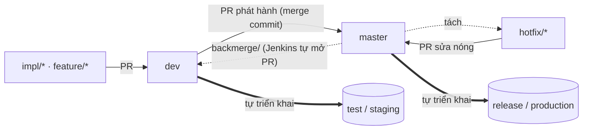

# Hợp đồng: Cổng chất lượng và luồng nhánh

Áp dụng cho `tooling/verify.mjs`, `ops/ci/Jenkinsfile.ci`, chặng đầu của `ops/ci/Jenkinsfile.deploy` và luật bảo vệ
nhánh trên GitHub. Lý do thiết kế: [research.md](../research.md) R4, R7–R12, R17.

## 1. Dòng lệnh `pnpm verify`

```text
pnpm verify                         # máy cá nhân: mọi bước; bước thiếu điều kiện được "bỏ qua"
pnpm verify --only <bước>[,<bước>]  # chạy đúng các bước nêu (lệnh "chạy lại cổng này")
pnpm verify --ci                    # bỏ qua = không đạt; áp ngoại lệ còn hạn; CI=true tương đương
pnpm verify --report <tệp.json>     # ghi GateResult (data-model.md mục 1)
```

Mã thoát: `0` khi `passed`, `1` khi không. Bảng tổng kết in ra màn hình giữ nguyên dạng hiện có, thêm trạng thái
`! ngoại lệ` và `· không áp dụng`.

## 2. Danh sách cổng

"Mới" = bước do tính năng này thêm. Cột FR-006 trỏ tới 7 mục của đặc tả.

| Bước | Lệnh | FR-006 | Cần | Ngoại lệ | Ghi chú |
|---|---|---|---|---|---|
| `build:shared` | `pnpm build:shared` | 4 | — | có | |
| `typecheck` | `pnpm typecheck` | 4 | — | có | |
| `lint` | `pnpm lint` | 4 | — | có | |
| `check:boundaries` | `pnpm check:boundaries` | 1 | — | có | luật sinh từ `modules.manifest.json`; module chưa khai báo → đỏ (FR-012) |
| `check:secrets` | `pnpm check:secrets` | 5 | — | **không** | gồm cả `ops/**`, `Jenkinsfile*`, `infra/ci/**` |
| `check:pipeline` *(mới)* | `pnpm check:pipeline` | — | — | có | phiên bản cố định, lược đồ tham số, ngoại lệ hợp lệ, `helm lint` |
| `check:release-source` *(mới)* | `pnpm check:release-source` | — | git, `GATE_TARGET_BRANCH` | **không** | mục 4 |
| `test` | `pnpm test` | 6 | — | có | |
| `check:web-bundle` | `pnpm check:web-bundle` | 6 | — | có | |
| `db:lint-migrations` | `pnpm db:lint-migrations` | 3 | git | có | thêm luật ở R11 |
| `db:immutable` *(mới)* | `pnpm db:immutable` | 3 | git | **không** | FR-019 |
| `test:db` | `pnpm test:db` | 2, 6 | PostgreSQL | **không** | gồm truy cập chéo, bao phủ theo catalog, kiểm kê đường vào, `db:check`, FR-021 |
| `test:queue` | `pnpm test:queue` | 6 | PostgreSQL | có | |
| `db:compat` *(mới)* | `pnpm db:compat` | 3 | PostgreSQL, git | có | FR-018; `COMPAT_BASE_SHA` |
| `check:secrets:test-logs` | `node tooling/scan-secrets.mjs apps/server/test-logs` | 5 | chạy sau các bước kiểm thử | **không** | |
| `test:e2e` | `pnpm test:e2e` | 6 | PostgreSQL, Chromium | có | |
| `check:image` *(mới)* | `pnpm check:image` | 7 | Docker, PostgreSQL | có | dựng ảnh, kiểm nội dung, chạy ba vai |

Biến môi trường do Jenkins đặt (trên máy cá nhân có mặc định): `TEST_DATABASE_ADMIN_URL`, `GATE_TARGET_BRANCH`
(`dev`|`master`), `GATE_SOURCE_BRANCH`, `MIGRATION_BASE_REF` (= `origin/<đích>`), `COMPAT_BASE_SHA`,
`STAGING_DEPLOYED_SHA`, `APP_VERSION`.

Quy tắc bất biến của hợp đồng:

1. **Không có kiểm tra nào chỉ tồn tại trong `Jenkinsfile`** (FR-007). `Jenkinsfile` chỉ được: chuẩn bị môi trường,
   gọi `pnpm verify --ci --only …`, đọc tệp báo cáo, đăng kết quả.
2. Thêm cổng = thêm một mục vào `DEFAULT_STEPS` + một dòng vào bảng này + (nếu cần) gán làn trong
   `ops/ci/gate-lanes.json`. `check:pipeline` đỏ nếu có bước không thuộc làn nào.
3. Trên Jenkins không có bước nào được bỏ qua (FR-008).

## 3. Kết quả trên pull request

| Kiểm tra (Checks) | Bắt buộc | Nội dung |
|---|---|---|
| `ci/gates` | **có** (duy nhất) | đạt khi `GateResult.passed`; phần tóm tắt là bảng tổng kết |
| `gate/<bước>` | không | mỗi bước một kiểm tra |

Mỗi `gate/<bước>` không đạt hiển thị đủ bốn thứ (FR-010): tên cổng · dòng lỗi đầu tiên · đường dẫn nhật ký đầy đủ
trên Jenkins · lệnh chạy lại (`rerun`). Cổng có ngoại lệ hiển thị kết luận `neutral` với tiêu đề
"VƯỢT CỔNG (ngoại lệ) – duyệt bởi …".

Chạy lại: người kích hoạt bấm "Re-run" trên GitHub hoặc "Replay/Rebuild" trên Jenkins; **không có tự động chạy lại
khi đỏ**; người chạy lại được ghi trong nguyên nhân của lần chạy.

## 4. Luồng nhánh và cổng `check:release-source`



| Đích | Nguồn | Điều kiện | Thông điệp khi không đạt |
|---|---|---|---|
| `dev` | bất kỳ | — | `not_applicable` |
| `master` | `dev` | đầu PR là tổ tiên của (hoặc bằng) SHA triển khai `staging` thành công gần nhất | "Commit `<sha>` chưa được triển khai thành công lên test. Chờ test xanh rồi chạy lại." |
| `master` | `dev` | `master` không có commit thường nào mà `dev` chưa có | "Bản sửa nóng `<sha>` chưa về dev – hợp nhất pull request backmerge #N trước." |
| `master` | `hotfix/*` | mọi commit trong `master..đầu PR` không thuộc `dev` | "Nhánh hotfix mang commit của dev: `<sha>`. Tách lại từ master." |
| `master` | khác | — | "master chỉ nhận từ dev hoặc hotfix/*." |

## 5. Luật bảo vệ nhánh (tóm tắt – chi tiết ở `ops/ci/github/rulesets/`)

Xem bảng ở research R7. Điểm hợp đồng: kiểm tra bắt buộc tên **`ci/gates`**, nguồn là GitHub App "ci"; `master` chỉ
cho phép **merge commit**; không ai có quyền vượt luật; `CODEOWNERS` yêu cầu SA/PO duyệt các đường dẫn
`ops/ci/**`, `ops/deploy/**`, `infra/ci/**`.

## 6. Ngoại lệ (FR-009)

1. Người đề xuất thêm tệp `ops/ci/exceptions/<ngày>-<cổng>.yml` (lược đồ: data-model.md mục 2) vào chính pull
   request cần vượt.
2. SA hoặc PO duyệt pull request với tư cách chủ mã của thư mục đó.
3. `pnpm verify --ci` báo cổng đó là `excepted`; `ci/gates` đạt; ngoại lệ hiện trong Checks, thông báo Telegram và
   `DeploymentRecord.gates.excepted`.
4. Hết hạn → tự vô hiệu; `check:pipeline` nhắc xóa tệp.

Cổng ghi "**không**" ở cột Ngoại lệ của mục 2 không bao giờ vượt được.

## 7. Hợp đồng `test:compat` (mọi phiên bản từ 008 trở đi)

```text
COMPAT_DATABASE_OWNER_URL / _APP_URL / _SYSTEM_URL / _SUPPORT_URL   # CSDL ĐÃ migrate bằng migration của bản mới
pnpm test:compat
```

- MUST NOT tự chạy migration, MUST NOT xóa/tạo lại schema.
- MUST khởi động `api` và `worker` của chính nó trên CSDL đó, chờ `/healthz` và `/readyz` đạt.
- MUST chạy tập kiểm thử hành vi trên CSDL và một vòng tạo việc → xử lý việc.
- MUST NOT chứa kiểm thử khẳng định cấu trúc (số migration, quy ước bảng, danh sách schema).
- Mã thoát `0` = bản này chạy được trên cấu trúc mới.
