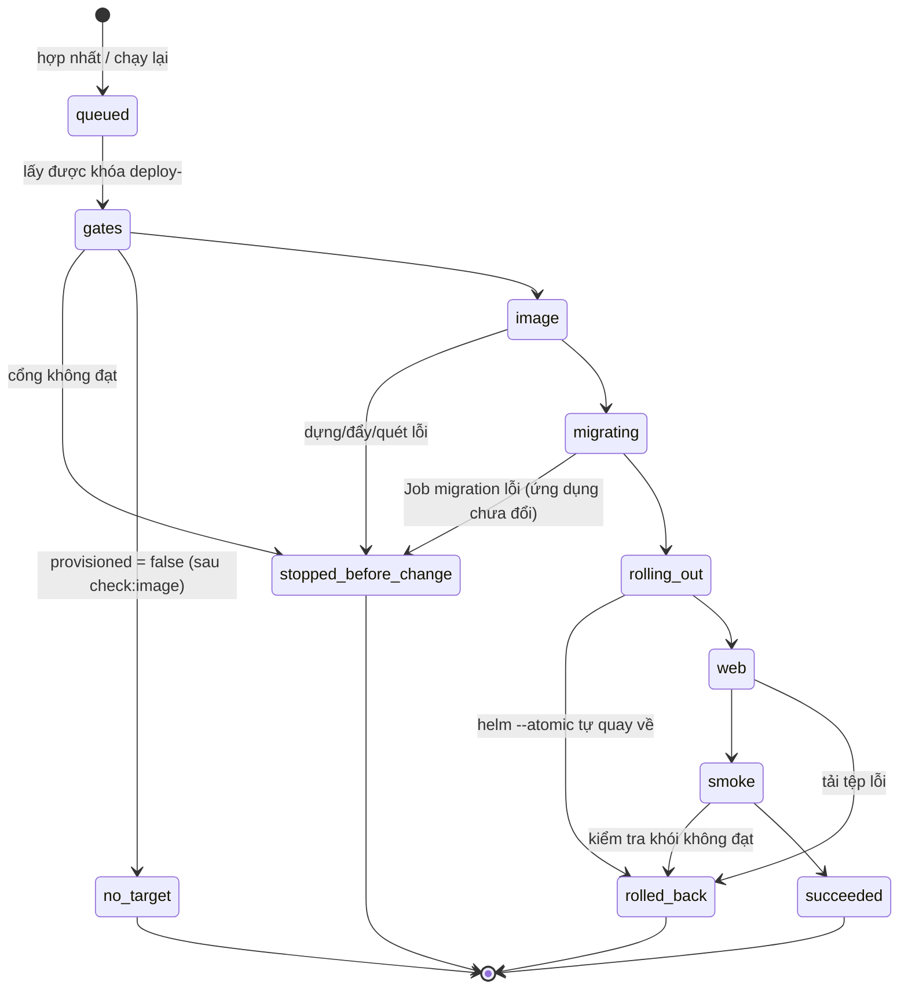

# Data Model: Quy trình tích hợp và triển khai tự động (Jenkins)

**Feature**: `008-cicd-jenkins-pipeline` · **Date**: 2026-11-13

Phần lớn thực thể của tính năng này **không nằm trong CSDL của ứng dụng**: chúng là tệp trong kho mã, bản ghi trên
GitHub hoặc đối tượng của Jenkins. Chỉ có một bảng mới (mục 8). Bảng dưới cho biết mỗi thực thể của đặc tả sống ở
đâu.

| Thực thể (đặc tả) | Tên trong mã | Nơi lưu | Thời gian giữ |
|---|---|---|---|
| Lần chạy quy trình | `pipeline run` | Jenkins (build) | 400 ngày |
| Cổng chất lượng + kết quả | `gate`, `GateResult` | `tooling/verify.mjs` (định nghĩa) · tệp báo cáo JSON · GitHub Checks | theo Jenkins / GitHub |
| Ảnh phát hành | `release image` | kho ảnh của môi trường | ≥ 10 bản release gần nhất và ≥ 90 ngày |
| Lần triển khai | `DeploymentRecord` | GitHub Deployments (`payload`) + sản phẩm lưu của Jenkins | không xóa (GitHub) |
| Môi trường đích | `EnvironmentParams` | `ops/deploy/env/{staging,production}.yaml` | theo Git |
| Migration | `migration` | `apps/server/drizzle/migrations/*.sql` + `infra.schema_migrations` | bất biến |
| Ngoại lệ vượt cổng | `GateException` | `ops/ci/exceptions/*.yml` | theo Git (hiệu lực ≤ 7 ngày) |
| Thông tin triển khai | `deploy credentials` | thông tin xác thực theo thư mục của Jenkins | xoay ≤ 90 ngày |

## 1. Kết quả cổng chất lượng – `GateResult` (tệp `--report`)

```jsonc
{
  "schema": 1,
  "commit": "<sha>",
  "mode": "ci",                         // "local" | "ci"
  "results": [
    {
      "name": "test:db",                // tên bước = tên kiểm tra trên GitHub: "gate/test:db"
      "status": "failed",               // "passed" | "failed" | "skipped" | "excepted" | "not_applicable"
      "seconds": 84.2,
      "firstError": "tenant_notes: tài khoản A đọc được dòng của B",
      "rerun": "pnpm verify --only test:db",
      "note": "",                       // lý do not_applicable / tên tệp ngoại lệ
      "exception": null                 // hoặc { "file": "ops/ci/exceptions/…yml", "approvedBy": "…" }
    }
  ],
  "passed": false
}
```

Quy tắc:

- `passed` = mọi kết quả thuộc `passed` | `excepted` | `not_applicable`.
- Chế độ `ci`: `skipped` **tính là không đạt** (FR-008). Chế độ `local`: `skipped` không tính.
- `not_applicable` chỉ được phát ra bởi chính bước đó kèm `note` (vd `db:compat`: "chưa có bản đang chạy",
  `check:release-source`: "đích không phải master") – không phải do thiếu điều kiện chạy.
- `excepted` chỉ có khi tồn tại `GateException` còn hạn cho đúng cổng và cổng đó cho phép ngoại lệ.

## 2. Ngoại lệ vượt cổng – `GateException`

Tệp `ops/ci/exceptions/<YYYY-MM-DD>-<slug>.yml`:

| Trường | Kiểu | Quy tắc |
|---|---|---|
| `gate` | chuỗi | tên một bước của `verify`; không thuộc danh sách cấm ngoại lệ (research R17) |
| `reason` | chuỗi ≥ 20 ký tự | vì sao phải vượt, kế hoạch sửa |
| `approvedBy` | tên GitHub | phải là SA hoặc PO (`ops/ci/team.json`, vai `release-manager`) |
| `expiresAt` | thời điểm ISO-8601 UTC | ≤ 7 ngày kể từ ngày trong tên tệp |
| `pullRequest` hoặc `commit` | số / SHA | phạm vi áp dụng; thiếu cả hai → không hợp lệ |

Trạng thái: *còn hạn* → áp dụng · *hết hạn* → bị bỏ qua và `check:pipeline` nhắc dọn. Ngoại lệ không hợp lệ làm
`check:pipeline` không đạt.

## 3. Ảnh phát hành

| Thuộc tính | Giá trị |
|---|---|
| Thẻ | SHA đầy đủ của commit trên `dev` / `master` |
| Định danh dùng khi triển khai | digest `sha256:…` |
| `APP_VERSION` (biến môi trường trong ảnh) | SHA đầy đủ – `api` và `worker` trả ở điểm sức khỏe |
| Nhãn OCI | `org.opencontainers.image.revision`, `.created`, `.source` |
| Kết quả quét lỗ hổng | số lượng theo mức, danh sách mức nghiêm trọng có bản vá – nằm trong `DeploymentRecord` |

Bất biến: một thẻ ↔ một digest, không đẩy đè; cùng một digest chạy ba vai `api` / `worker` / `migrate`.

## 4. Bản ghi triển khai – `DeploymentRecord` (`payload` của GitHub Deployment)

```jsonc
{
  "schema": 1,
  "environment": "staging",             // "staging" | "production"
  "kind": "release",                    // "release" | "hotfix" | "redeploy"
  "commit": "<sha>",
  "image": { "repository": "…/app", "digest": "sha256:…", "reused": false },
  "mergedBy": "<tên GitHub>",
  "approvedBy": ["<tên GitHub>"],
  "pullRequest": 123,
  "jenkins": { "job": "deploy/staging/deploy", "build": 57, "url": "https://…" },
  "gates": { "passed": true, "excepted": [] },            // rút gọn từ GateResult
  "vulnerabilities": { "critical": 0, "criticalFixable": 0, "blocked": false },
  "migrations": ["0014_….sql"],         // tệp được áp ở lần này ([] nếu không có)
  "steps": [
    { "name": "gates",   "status": "passed", "seconds": 512 },
    { "name": "image",   "status": "passed", "seconds": 95 },
    { "name": "migrate", "status": "passed", "seconds": 8 },
    { "name": "rollout", "status": "passed", "seconds": 140 },
    { "name": "web",     "status": "passed", "seconds": 20 },
    { "name": "smoke",   "status": "passed", "seconds": 25 },
    { "name": "notify",  "status": "passed", "seconds": 1 }
  ],
  "rolledBack": false,
  "previous": { "commit": "<sha>", "digest": "sha256:…", "helmRevision": 41 },
  "redeploy": null,                     // hoặc { "requestedBy": "…", "reason": "…" }
  "notifyErrors": []
}
```

Bản ghi **không chứa**: bí mật, địa chỉ nội bộ (ngoài đường dẫn Jenkins), nội dung nhật ký, dữ liệu khách hàng.

### Chuyển trạng thái của một lần triển khai



Ánh xạ sang trạng thái GitHub Deployment: `succeeded` → `success`; `rolled_back` → `failure` (mô tả "đã quay về bản
trước"); `stopped_before_change` → `failure` (mô tả nêu bước hỏng); `no_target` → không tạo Deployment. Không có
trạng thái nào quay lui cấu trúc CSDL.

## 5. Tham số môi trường – `EnvironmentParams`

Tệp `ops/deploy/env/<env>.yaml` (không bí mật; nguồn: danh sách đầu ra FR-024 của `007`):

| Trường | Ý nghĩa |
|---|---|
| `name` | `staging` \| `production` |
| `branch` | `dev` \| `master` – quy trình từ chối nếu nhánh đang chạy khác giá trị này |
| `provisioned` | `false` → dừng với kết quả "chưa có môi trường đích" |
| `registry.repository` | kho ảnh của môi trường |
| `cluster.server`, `cluster.namespaces.app`, `cluster.namespaces.migrate` | điểm quản trị cụm và hai namespace |
| `api.baseUrl`, `web.baseUrl` | địa chỉ HTTPS công khai |
| `web.bucket`, `web.s3Endpoint`, `web.s3Region` | nơi phục vụ giao diện tĩnh |
| `web.buildEnv` | biến dựng giao diện (không bí mật) |
| `replicas.api`, `replicas.worker` | số bản chạy |
| `secrets.app`, `secrets.dbOwner` | **tên** các Secret trong cụm (không phải giá trị) |
| `vulnerabilityPolicy` | `block` (release) \| `warn` (test) |
| `rollout.timeoutSeconds`, `smoke.timeoutSeconds` | thời hạn |

Hai tệp cùng một lược đồ (`ops/deploy/env/schema.json`); `check:pipeline` kiểm cả hai.

## 6. Thông tin triển khai (trong Jenkins)

| Mã định danh | Thư mục | Nội dung | Quyền tối thiểu |
|---|---|---|---|
| `github-app-ci` | `ci/` | khóa App "ci" | đọc nội dung, đọc pull request, ghi Checks, **đọc** Deployments |
| `github-app-deploy` | `deploy/` | khóa App "deploy" | ghi nội dung (nhánh `backmerge/*`), ghi pull request, ghi Deployments |
| `telegram-bot` | `deploy/` | mã bot + mã nhóm | gửi tin vào một nhóm |
| `registry` | `deploy/<env>/` | tài khoản kho ảnh | đẩy/kéo/xóa trong kho ảnh của môi trường đó |
| `kubeconfig` | `deploy/<env>/` | mã của ServiceAccount `ci-deployer` | Role ở research R15 |
| `static-site` | `deploy/<env>/` | khóa S3 | chỉ kho tệp tĩnh của môi trường đó |
| `smoke` | `deploy/<env>/` | mã kiểm tra khói + tài khoản kiểm tra nội bộ | chỉ `POST /ops/smoke` và đăng nhập tài khoản đó |

Jenkins **không** giữ: mật khẩu vai trò `owner`/`app`/`system`/`support`, khóa kho tệp media, khóa KMS.

## 7. Migration (bổ sung thuộc tính quy trình)

| Thuộc tính | Quy tắc |
|---|---|
| Bất biến | tệp đã có trên `dev`/`master` không được sửa/xóa; `_journal.json` chỉ nối thêm (`db:immutable`) |
| Phân loại | *mở rộng* (mặc định) · *thu hẹp có khai báo* (`-- breaking-ok: <lý do>` ngay trên câu lệnh) |
| Điều kiện qua cổng | mở rộng: qua luật tĩnh · thu hẹp: có khai báo **và** `db:compat` đạt với bản đang chạy ở môi trường đích |
| Áp dụng | Job `migrate-<sha12>` bằng vai trò `owner`; danh sách tệp đã áp ghi vào `DeploymentRecord.migrations` |

## 8. Bảng mới trong CSDL: `infra.smoke_pings`

Thuộc module `queue` (schema `infra`), loại bảng **dùng chung** (`sharedTable` – không có `account_id`, không chứa
dữ liệu khách hàng).

| Cột | Kiểu | Ghi chú |
|---|---|---|
| `id` | `uuid` PK | UUID v7 sinh ở ứng dụng |
| `requested_at` | `timestamptz NOT NULL` | API ghi |
| `api_version` | `text NOT NULL` | `APP_VERSION` của bản API nhận yêu cầu |
| `processed_at` | `timestamptz` | Worker ghi |
| `worker_version` | `text` | `APP_VERSION` của bản Worker xử lý |

- Quyền: `app` được `INSERT`, `SELECT`; `system` được `SELECT`, `UPDATE (processed_at, worker_version)`; `support`
  không có quyền.
- Ghi dòng và tạo việc `queue.smoke_ping` trong **cùng giao dịch** (nguyên tắc IV, V). Bộ xử lý dùng cập nhật có
  điều kiện `WHERE processed_at IS NULL` → chạy lại an toàn.
- Việc dọn dẹp hằng ngày đã có xóa dòng cũ hơn 7 ngày.
- Migration chỉ thêm (tương thích ngược).

## 9. Thuật ngữ mới (Việt → Anh) – bổ sung `.specify/memory/architecture.md` mục 11 lúc implement

| Đặc tả | Mã nguồn |
|---|---|
| cổng chất lượng / kết quả cổng | `gate` / `GateResult` |
| chặng kiểm tra / chặng triển khai | `ci/gates` (`Jenkinsfile.ci`) / `deploy` (`Jenkinsfile.deploy`) |
| môi trường test / release | `staging` / `production` |
| ảnh phát hành | `release image` (thẻ = SHA, triển khai theo `digest`) |
| lần triển khai / bản ghi triển khai | `deployment` / `DeploymentRecord` |
| sửa nóng / đưa bản sửa về `dev` | `hotfix` / `backmerge` (nhánh `backmerge/<sha12>`) |
| triển khai lại bản cũ | `redeploy` |
| quay về bản trước | `rollback` |
| ngoại lệ vượt cổng | `GateException` (`ops/ci/exceptions/`) |
| kiểm tra khói / việc thử | `smoke` / `queue.smoke_ping`, bảng `infra.smoke_pings` |
| kiểm tra tương thích ngược tĩnh / động / bất biến | `db:lint-migrations` / `db:compat` / `db:immutable` |
| cổng nguồn phát hành | `check:release-source` |
| tham số môi trường | `EnvironmentParams` (`ops/deploy/env/*.yaml`) |
| thông tin triển khai | `deploy credentials` (theo thư mục Jenkins) |
| tác nhân kiểm tra / triển khai | agent `ci` / agent `deploy` |
