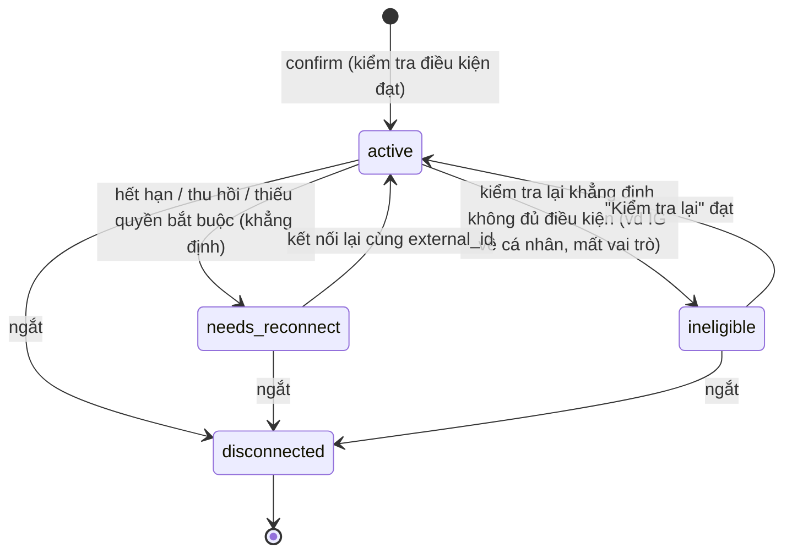

# Data Model – 010 Kết nối kênh

Schema `platform_gateway` (module `platform_gateway`, `kind: gateway`). Quy ước chung của dự án: PK UUID v7 sinh ở ứng dụng, thời gian
`timestamptz` UTC, bảng tenant dùng `tenantTable` (cột `id, account_id, created_at, updated_at` + RLS `tenant_isolation`), khóa lạc quan
`version` qua `updateVersioned`. Migration **tương thích ngược** (API/Worker bản cũ và mới chạy song song): chỉ *thêm* bảng/cột; không đổi tên, không xóa.

Ánh xạ tên VN → EN: `ket_noi_kenh` → `channel_connections` · `phien_ket_noi` → `connect_states` / `connect_selections` ·
`cong_tac_tinh_nang` → `feature_overrides` / `gateway_settings` · `ket_noi_kenh_id` → `channel_connection_id` · `Cổng nền tảng` → `platform_gateway`.

## 1. `channel_connections` (tenant)

| Cột | Kiểu | Ghi chú |
|---|---|---|
| `id` | uuid v7 PK | mã kết nối – **không đổi** khi kết nối lại (FR-008) |
| `account_id` | uuid NOT NULL → `accounts.id` ON DELETE CASCADE | |
| `channel_type` | text | CHECK ∈ (`facebook_page`,`instagram`,`tiktok`,`zalo_oa`,`test_channel`) |
| `external_id` | text NOT NULL | mã Page / `ig_user_id` / `open_id` TikTok; ≤ 200 |
| `display_name` | varchar(120) NOT NULL | tên Page/@username (cắt 120) |
| `avatar_url` | text NULL | ảnh đại diện công khai của nền tảng (https, ≤ 500); không phải dữ liệu bí mật |
| `account_type` | text NULL | `page`, `instagram_business`, `instagram_creator`, `tiktok_creator`… (từ `checkAccount`) |
| `granted_scopes` | text[] NOT NULL DEFAULT '{}' | quyền đã cấp (chỉ tên quyền) |
| `quota_remaining` | integer NULL | chỉ khi nền tảng cho biết (FR-009d, US3-3) |
| `source_connection_id` | uuid NULL → `channel_connections.id` | **chỉ Instagram**: Page nguồn (FR-042). Cùng module nên được phép có khóa ngoại |
| `token_ciphertext` | bytea NOT NULL | mã quyền truy cập **đã mã hóa** (R10). `NULL` không cho phép trừ khi `status='disconnected'` |
| `refresh_ciphertext` | bytea NULL | mã người dùng dài hạn (Meta) / `refresh_token` (TikTok), mã hóa |
| `token_issued_at` | timestamptz NOT NULL | dùng để chọn bản mới hơn khi đua (Worker vs kết nối lại) |
| `expiry_kind` | text NOT NULL | `none` \| `token` \| `data_access` (R2) |
| `token_expires_at` | timestamptz NULL | **NULL ⇔ `expiry_kind='none'`** (CHECK) |
| `status` | text NOT NULL | CHECK ∈ (`active`,`needs_reconnect`,`ineligible`,`disconnected`); `expiring`/`suspended` là **dẫn xuất** (R4) |
| `reason_code` | text NULL | mã lý do gần nhất của `needs_reconnect`/`ineligible` (đã lọc `[A-Za-z0-9_.:-]{1,64}`) |
| `last_error_code` | text NULL | mã lỗi gốc nền tảng gần nhất (chỉ hiện ở "Chi tiết cho hỗ trợ", FR-016) |
| `last_checked_at` | timestamptz NULL | lần `checkAccount` gần nhất thành công/kết luận |
| `last_refreshed_at` | timestamptz NULL | |
| `last_manual_check_at` | timestamptz NULL | giới hạn tần suất "Kiểm tra lại" (cập nhật có điều kiện) |
| `recheck_required` | boolean NOT NULL DEFAULT false | bật khi gói hết hạn đã bỏ qua kiểm tra / công tắc đổi (R11) |
| `last_notified_stage` | text NULL | `d7` \| `d1` \| `expired` – chống nhắc lặp (cùng khóa chống trùng thông báo) |
| `connected_at` | timestamptz NOT NULL | |
| `disconnected_at` | timestamptz NULL | **NOT NULL ⇔ `status='disconnected'`** (CHECK) |
| `created_at`, `updated_at` | | |
| `version` | integer NOT NULL DEFAULT 1 | khóa lạc quan |

**Ràng buộc/chỉ mục**

- `CHECK ((status='disconnected') = (disconnected_at IS NOT NULL))`; `CHECK ((expiry_kind='none') = (token_expires_at IS NULL))`.
- `CHECK (channel_type='instagram' OR source_connection_id IS NULL)`; `CHECK (source_connection_id IS DISTINCT FROM id)`.
- **Duy nhất toàn cục (ngoại lệ có lý do của quy tắc "chỉ mục bắt đầu bằng `account_id`")**: `UNIQUE (channel_type, external_id) WHERE status <> 'disconnected'` — FR-006. Khai báo trong `indexExceptions` với lý do "một Page chỉ thuộc một tài khoản". Chỉ mục này **không** lộ dữ liệu: vi phạm trả cùng một mã lỗi.
- `(account_id, channel_type) WHERE status <> 'disconnected'` — đếm giới hạn N + liệt kê.
- `(account_id, source_connection_id) WHERE source_connection_id IS NOT NULL` — tìm Instagram phụ thuộc một Page.
- `(token_expires_at) WHERE status = 'active'` + `(last_checked_at)` — cho `list_due_connections` (hàm `SECURITY DEFINER`, chỉ `app`/`system` chạy; chỉ mục đặt *sau* `account_id` chỉ khi có phép lọc tenant; chỉ mục theo hạn là ngoại lệ có lý do thứ hai "quét định kỳ hệ thống").
- RLS: `tenant_isolation` (`account_id = account.current_account_id()`); `app` đọc/ghi; `system` đặt ngữ cảnh tenant một tài khoản; `support` **chỉ** qua khung nhìn `support_channel_view`.

**Khung nhìn hỗ trợ `platform_gateway.support_channel_view`**: `id, account_id, channel_type, display_name, state(status), token_expires_at, expiry_kind, last_checked_at, last_error_code, connected_at` — **không** có cột `*_ciphertext`, `granted_scopes` không cần. Mọi truy vấn ghi `support.view_channel`.

### Máy trạng thái (lưu)

Mọi chuyển là `UPDATE … SET status=:new, version=version+1 … WHERE id=:id AND version=:v` (và/hoặc `AND status=:expected`); 0 dòng ⇒ đọc lại, kết quả đua được quyết theo `token_issued_at` (bản mới hơn thắng, không ghi đè quyền mới bằng quyền cũ).
Lỗi **tạm thời** (`transient`) khi kiểm tra/làm mới **không** chuyển trạng thái (FR-012): chỉ ghi `last_error_code` và để lần sau.

### Trạng thái hiển thị (dẫn xuất) – hàm thuần `deriveState`

Đầu vào: hàng kết nối + (hàng Page nguồn) + `featureEnabled` + `now` + `warnDays`.

| Điều kiện (ưu tiên từ trên xuống) | `state` | `reasonCode` | `status` công khai |
|---|---|---|---|
| `status='disconnected'` | `disconnected` | — | `disconnected` |
| `channel_type='tiktok'` và công tắc tắt/không đọc được | `suspended` | `FEATURE_OFF` | `disconnected` |
| `channel_type='instagram'` và Page nguồn không còn `active/expiring` (hoặc đã ngắt) | `needs_reconnect` | `SOURCE_PAGE_LOST` | `expired` |
| `status='needs_reconnect'` | `needs_reconnect` | `reason_code` | `expired` |
| `status='ineligible'` | `ineligible` | `reason_code` | `expired` |
| `status='active'` và `token_expires_at` có và `< now + warnDays` | `expiring` | `TOKEN_EXPIRING` | `expiring` |
| `status='active'` và `token_expires_at <= now` | `needs_reconnect` | `TOKEN_EXPIRED` | `expired` |
| `status='active'` | `active` | — | `active` |

"Chưa kết nối" là trạng thái **không có hàng** (giao diện vẽ nút "Kết nối …" theo nền tảng).

## 2. `connect_states` (tenant) – chống giả mạo luồng cấp quyền

| Cột | Kiểu | Ghi chú |
|---|---|---|
| `id`, `account_id`, `created_at`, `updated_at` | chuẩn | |
| `state_hash` | bytea NOT NULL UNIQUE | SHA-256 của `state` 32 byte ngẫu nhiên; **không lưu bản rõ** |
| `user_id` | uuid NOT NULL | người khởi động (chủ) |
| `channel_type` | text NOT NULL | |
| `reconnect_connection_id` | uuid NULL → `channel_connections.id` | nếu là kết nối lại |
| `expires_at` | timestamptz NOT NULL | +10 phút (`channel.selection_ttl_sec`) |
| `used_at` | timestamptz NULL | dùng một lần (cập nhật có điều kiện) |

Chỉ mục `(account_id, expires_at)`; việc dọn xóa `expires_at < now() - 1 giờ OR used_at IS NOT NULL`.

## 3. `connect_selections` (tenant) – phiên chọn Page (dữ liệu tạm)

| Cột | Kiểu | Ghi chú |
|---|---|---|
| `id`, `account_id`, `created_at`, `updated_at` | chuẩn | |
| `user_id` | uuid NOT NULL | chỉ người này đọc được (so với phiên) |
| `channel_type` | text NOT NULL | |
| `candidates` | jsonb NOT NULL | mảng `{externalId, displayName, avatarUrl?, accountType?, sourceExternalId?, tokenCiphertextB64, refreshCiphertextB64?, expiry:{kind, expiresAt?}, check}`; **mã quyền chỉ ở dạng mã hóa** (CHECK `jsonb_typeof='array' AND jsonb_array_length <= 100`) |
| `expires_at` | timestamptz NOT NULL | +10 phút |
| `used_at` | timestamptz NULL | |

`check` = kết quả `AccountCheckResult` (đã chuẩn hóa, **không** chứa mã quyền). Sau `confirm` (hoặc hết hạn) dòng bị xóa; mã quyền của ứng viên *không được chọn* bị hủy cùng dòng.

## 4. `feature_overrides` (tenant) – ghi đè công tắc theo tài khoản

| Cột | Kiểu | Ghi chú |
|---|---|---|
| `id`, `account_id`, `created_at`, `updated_at` | chuẩn | |
| `flag_key` | text NOT NULL | giai đoạn 1: `channel.tiktok` (CHECK ∈ danh sách khóa hợp lệ) |
| `value` | boolean NOT NULL | bật/tắt; "theo mặc định" = **xóa dòng** |
| `reason` | varchar(500) NOT NULL | lý do (bắt buộc – FR-037) |
| `changed_by_staff_id` | uuid NOT NULL | nhân viên đặt (không FK tới schema `account`: tham chiếu theo mã – ADR-09) |

`UNIQUE (account_id, flag_key)`. Xóa tài khoản ⇒ cascade (Edge Case "bị xóa cùng dữ liệu tài khoản").

## 5. `feature_override_events` (tenant, chỉ thêm) – nhật ký đổi công tắc

`id, account_id, created_at`, `flag_key`, `old_value` (`on|off|default`), `new_value`, `reason`, `changed_by_staff_id`, `trace_id`. Không `UPDATE/DELETE` (quyền SQL của `app` chỉ `INSERT, SELECT`). Giữ 12 tháng (Hiến pháp VII); thay đổi **mặc định hệ thống** ghi vào `infra.audit_log` (không có tenant) kèm cùng trường.

## 6. `gateway_settings` (dùng chung, `sharedTable`, **không** `account_id`)

| `key` (text PK) | `value` (jsonb) | Mặc định | Dùng ở |
|---|---|---|---|
| `channel.tiktok.enabled_default` | boolean | `false` | R5, FR-036 |
| `channel.max_per_platform` | integer | `5` | R8, FR-007 |
| `channel.expiry_warn_days` | integer | `7` | R2, FR-020 |
| `channel.manual_check_cooldown_sec` | integer | `20` | FR-011 |
| `channel.selection_ttl_sec` | integer | `600` | FR-004 |
| `channel.check_batch_limit` | integer | `500` | R11 |

Cột `updated_at`, `updated_by` (staff). Đọc: cache trong tiến trình ≤ 60 giây. Ghi: chỉ nhân viên `admin` (`feature.manage`) qua `features.service`, ghi `audit_log`. Dữ liệu gốc nạp bằng migration (dữ liệu, không mã).

## 7. Tham chiếu liên module (không khóa ngoại – ADR-09)

| Từ | Tới | Cách |
|---|---|---|
| `content.channel_variants.connection_id`, `publishing.publish_attempts.channel_connection_id` | `channel_connections.id` | chỉ mã tham chiếu; kiểm khi ghi qua `PLATFORM_GATEWAY.getConnection` (đã có ở 012/013) |
| `feature_overrides.changed_by_staff_id` | `account.staff_users.id` | mã tham chiếu |
| `connect_*.user_id` | `account.users.id` | mã tham chiếu (từ phiên) |

## 8. Dữ liệu cá nhân & bên nhận (Hiến pháp VII)

Lưu: tên Page/@username/ảnh đại diện công khai + mã nền tảng (dữ liệu *kênh của doanh nghiệp*, ≤ 120 ký tự) – **không** email, số điện thoại, danh sách người theo dõi, tin nhắn (FR-016). Mã quyền: chỉ bản mã. Bên nhận ở nước ngoài: Meta (đã có), **TikTok (mới – cần thêm vào Kiến trúc dữ liệu mục 9 và hồ sơ Q-D3/C6)**; dữ liệu gửi đi trong luồng kết nối chỉ gồm `code`, mã ứng dụng và `redirect_uri`.
Vòng đời: ngắt ⇒ `token_ciphertext`/`refresh_ciphertext` **đặt NULL ngay** (CHECK cho phép khi `status='disconnected'`), giữ hàng định danh để truy vết lượt đăng; xóa tài khoản ⇒ hàng bị xóa cascade; sao lưu theo chính sách CSDL.

## 9. Kiểm thử bắt buộc cho dữ liệu này (CI)

1. Truy cập chéo mọi bảng tenant (A đọc/sửa/xóa/đoán mã của B → thất bại, không phân biệt "không tồn tại" – SC-004).
2. Công cụ phát hiện bảng có `account_id` mà thiếu RLS (đã có) chạy trên 5 bảng mới.
3. Đọc thô `channel_connections` → không thấy mã quyền dạng rõ; quét nhật ký mẫu/phản hồi bằng mẫu `fake_tok_*`, `EAA…`, `act.…` (SC-003).
4. Đua: hai `confirm` cùng Page; chọn quá giới hạn song song; Worker làm mới × người dùng kết nối lại; hai Worker cùng `check_connection`.
5. Ánh xạ `state → status` theo bảng; bất biến "dùng được ⇔ `active|expiring`".
