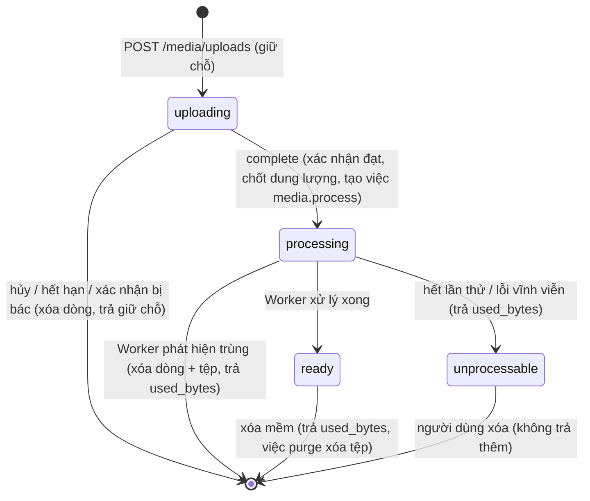
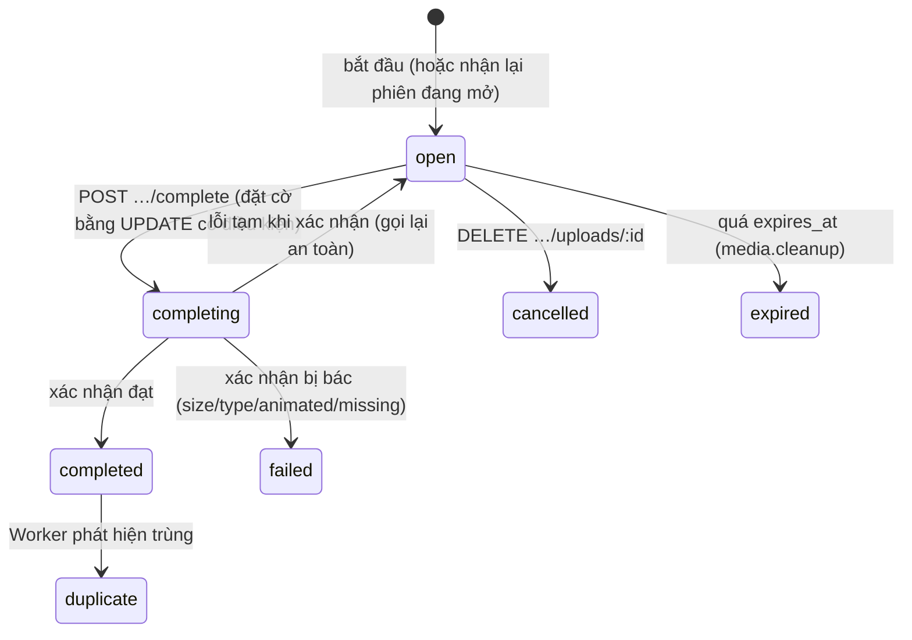

# Data Model: Thư viện media cơ bản (014)

**Spec**: [spec.md](./spec.md) · **Research**: [research.md](./research.md)

Schema `media` (module `media`). Mọi bảng dùng `tenantTable` (tự có `id` UUID v7, `account_id NOT NULL` FK → `account.accounts` CASCADE, `created_at`,
`updated_at`, chỉ mục đầu `account_id`, chính sách RLS `tenant_isolation`). Chỉ FK **nội bộ module** và tới `accounts`; người tải là **mã tham chiếu**
(không FK) tới `account.users` (ADR-09). Migration chỉ **thêm** (tương thích ngược).

## 1. Bảng mới

### 1.1 `media.media` (xóa mềm)

Một ảnh/video của một tài khoản. `tenantTable(media, 'media', {...}, …, { softDelete: true })` ⇒ thêm `deleted_at`.

| Cột | Kiểu | Quy tắc |
|---|---|---|
| `kind` | `text` | `'image' \| 'video'` (CHECK) |
| `status` | `text` | `'uploading' \| 'processing' \| 'ready' \| 'unprocessable'` (CHECK) — xem mục 2 |
| `display_name` | `text` | 1–255 ký tự, đã chuẩn hóa (bỏ ký tự điều khiển/`/`/`\`); **không bao giờ** vào khóa kho |
| `original_content_type` | `text` | từ dò nội dung thật (R8), thuộc `ALLOWED_CONTENT_TYPES` |
| `original_bytes` | `bigint` | > 0; kích thước tệp gốc đã xác nhận bằng `stat`; **đây là số tính vào hạn mức** (FR-008) |
| `file_hash` | `char(64)` | SHA-256 hex thường, NULL tới khi Worker tính; CHECK `~ '^[0-9a-f]{64}$'` |
| `width`, `height` | `integer` | điểm ảnh của **ảnh gốc đã xoay đúng chiều** (ảnh) / khung hình (video); NULL tới khi `ready` |
| `duration_ms` | `integer` | chỉ video; CHECK `kind = 'video' OR duration_ms IS NULL` |
| `normalized_bytes`, `thumb_bytes` | `bigint` | kích thước bản phái sinh (đối soát kho tổng; **không** tính hạn mức) |
| `uploaded_by_user_id` | `uuid` | mã tham chiếu `account.users`; phục vụ "cộng tác viên chỉ xóa tệp của mình" (FR-018) |
| `failure_code` | `text` | NULL trừ khi `unprocessable`: `corrupt \| unsupported \| too_many_pixels \| animated \| no_video_stream \| storage_mismatch` |
| `processed_at` | `timestamptz` | thời điểm sang `ready` hoặc `unprocessable` |
| `files_purged_at` | `timestamptz` | thời điểm việc nền đã xóa hết tệp thật (sau xóa mềm) |

**Ràng buộc & chỉ mục**
- `UNIQUE (account_id, file_hash) WHERE file_hash IS NOT NULL AND deleted_at IS NULL AND status IN ('processing','ready')` — chống trùng (R3).
- `CHECK (status <> 'ready' OR (file_hash IS NOT NULL AND width IS NOT NULL AND height IS NOT NULL AND processed_at IS NOT NULL))`.
- `CHECK (status <> 'ready' OR kind <> 'image' OR normalized_bytes IS NOT NULL)`; `CHECK (status <> 'ready' OR thumb_bytes IS NOT NULL)`.
- `CHECK (status <> 'unprocessable' OR failure_code IS NOT NULL)`.
- `(account_id, created_at DESC, id) WHERE deleted_at IS NULL AND status <> 'uploading'` — lưới mới nhất trước, phân trang theo con trỏ.
- `(account_id, kind, created_at DESC) WHERE deleted_at IS NULL AND status <> 'uploading'` — lọc theo loại.
- `(account_id, uploaded_by_user_id)` — kiểm quyền xóa, báo cáo.
- Tìm theo tên: `lower(display_name) LIKE '%q%'` lọc trong phạm vi `account_id` (≤ vài nghìn dòng/tài khoản; không cần trigram — không thêm extension).

### 1.2 `media.upload_sessions`

Một lần tải của một tệp; giữ phần đã giữ chỗ và cho phép tiếp tục.

| Cột | Kiểu | Quy tắc |
|---|---|---|
| `media_id` | `uuid` | FK nội bộ → `media.media` ON DELETE CASCADE |
| `created_by_user_id` | `uuid` | mã tham chiếu `account.users` |
| `fingerprint` | `char(64)` | SHA-256 hex của `tên\|dung lượng\|lastModified` do web tính (R2) |
| `mode` | `text` | `'single' \| 'multipart'` |
| `declared_bytes` | `bigint` | > 0; dung lượng khai báo = số được **giữ chỗ**; xác nhận phải khớp `stat` |
| `declared_content_type` | `text` | loại khai báo; phải khớp loại dò được lúc xác nhận |
| `multipart_upload_id` | `text` | chỉ `mode = 'multipart'`; **không** vào nhật ký/chỉ số/phản hồi ngoài `part-urls` |
| `part_size_bytes`, `part_count` | `integer` | chỉ multipart; `part_count = ceil(declared_bytes / part_size_bytes)` |
| `state` | `text` | `open \| completing \| completed \| cancelled \| expired \| failed \| duplicate` (CHECK) — mục 2 |
| `failure_code` | `text` | khi `failed`: `size_mismatch \| type_mismatch \| type_unsupported \| animated \| missing_object \| plan_expired` |
| `duplicate_of_media_id` | `uuid` | khi `duplicate`: media đã có (mã tham chiếu cùng schema, không FK để tránh khóa vòng khi xóa) |
| `last_activity_at` | `timestamptz` | cập nhật khi bắt đầu/lấy URL phần/xác nhận |
| `expires_at` | `timestamptz` | `last_activity_at + 24 giờ` (`MEDIA_LIMITS.sessionTtlSec`), cập nhật cùng `last_activity_at` |
| `completed_at` | `timestamptz` | |

**Chỉ mục**: `UNIQUE (account_id, created_by_user_id, fingerprint) WHERE state IN ('open','completing')` (một phiên đang hoạt động cho mỗi tệp/người);
`(account_id, expires_at) WHERE state = 'open'` (quét quá hạn); `(account_id, media_id)`.

### 1.3 `media.storage_quotas`

Một dòng/tài khoản; **không cache** (hiến pháp, FR-028).

| Cột | Kiểu | Quy tắc |
|---|---|---|
| `used_bytes` | `bigint` | ≥ 0 — Σ `original_bytes` của media `processing`/`ready` chưa xóa |
| `reserved_bytes` | `bigint` | ≥ 0 — Σ `declared_bytes` của phiên `open`/`completing` |
| `limit_bytes` | `bigint` | > 0; mặc định `MEDIA_QUOTA_BYTES` = 5 × 1024³ lúc tạo dòng |

`UNIQUE (account_id)`; `CHECK (used_bytes >= 0 AND reserved_bytes >= 0 AND used_bytes + reserved_bytes <= limit_bytes)` — chốt chặn cuối (SC-005).

**Mọi thay đổi bộ đếm là một câu UPDATE có điều kiện, cùng giao dịch với dòng `media`/`upload_sessions`:**

| Thao tác | Câu lệnh rút gọn | Điều kiện / nếu 0 dòng |
|---|---|---|
| Giữ chỗ (bắt đầu tải) | `SET reserved_bytes = reserved_bytes + :n WHERE used_bytes + reserved_bytes + :n <= limit_bytes` | 0 dòng ⇒ `MEDIA_QUOTA_EXCEEDED` (không tải byte nào) |
| Chốt (xác nhận đạt) | `SET reserved_bytes = reserved_bytes - :d, used_bytes = used_bytes + :real WHERE reserved_bytes >= :d` | `:d` = `declared_bytes`; `:real` = `stat.bytes` (= `:d` vì đã bác lệch) |
| Trả giữ chỗ (hủy / lỗi / hết hạn) | `SET reserved_bytes = reserved_bytes - :d WHERE reserved_bytes >= :d` | chạy lại: phiên đã đóng ⇒ bỏ qua |
| Trả dung lượng (xóa / trùng / không xử lý được) | `SET used_bytes = used_bytes - :b WHERE used_bytes >= :b` | chỉ khi dòng `media` vừa chuyển trạng thái nhờ `UPDATE … WHERE status IN (…) RETURNING` |

## 2. Trạng thái và chuyển trạng thái

Mọi chuyển là `UPDATE … WHERE status = :expected RETURNING` (hiến pháp II/V); 0 dòng ⇒ đã có người làm ⇒ coi như thành công không tác dụng phụ.

### `media.media.status`

- Lưới thư viện **không** hiện `uploading`; hiện `processing` ("Đang xử lý", chưa đính được – FR-013), `ready`, `unprocessable` (nút Xóa).
- `[*]` ở trạng thái xóa mềm: dòng còn 30 ngày với `deleted_at` rồi bị `media.cleanup` xóa hẳn.

### `media.upload_sessions.state`

`complete` gọi lặp an toàn: `completed` ⇒ trả kết quả cũ; `completing` do một yêu cầu khác ⇒ chờ ngắn rồi trả trạng thái hiện tại.

## 3. Việc nền (queue `media`, `scheduled`)

Khai báo ở `modules/media/jobs.ts`; payload `z.strictObject` chỉ mã tham chiếu (không `accountId`, không tên tệp).

| Loại việc | Hàng chờ · phạm vi | Payload | Khóa chống trùng | Tạo khi | Idempotent bằng |
|---|---|---|---|---|---|
| `media.process` | `media` · tenant | `{ mediaId }` | `media_process:{mediaId}` | `complete` đạt (cùng giao dịch) | khóa đối tượng cố định theo `mediaId`; `status <> 'processing'` ⇒ bỏ qua |
| `media.purge_files` | `media` · tenant | `{ mediaId }` | `media_purge:{mediaId}` | xóa mềm (cùng giao dịch) | xóa đối tượng không có ⇒ không lỗi; `files_purged_at` |
| `media.cleanup` | `media` · tenant | `{ scope: 'stale' \| 'full' }` | `media_cleanup:{accountId}:{scope}` | `media.sweep` | mỗi bước đọc trạng thái rồi mới làm |
| `media.sweep` | `scheduled` · system | `{}` | theo khung (`defineSchedule`) | cron `7 * * * *` (UTC) hằng giờ + `full` mỗi Chủ nhật | chỉ tạo việc, dedupe theo tài khoản |

- **Thử lại `media.process`** theo cấu hình hàng chờ (3 lần: 60 → 300 → 900 giây). Lỗi **vĩnh viễn** (tệp hỏng/không hỗ trợ/quá điểm ảnh/ảnh động/không có luồng hình): bộ xử lý ghi
  `unprocessable` + trả `used_bytes` rồi `return noRetry(code)` — **không** vào `dead_jobs`. Lỗi **tạm** (kho/ffmpeg bị ngắt): ném lỗi để hàng chờ thử lại; `onFinalFailure` chuyển
  sang `unprocessable` (`failure_code = 'storage_mismatch'` hoặc mã thực).
- **Hàm SQL** `media.list_cleanup_accounts(kind text, cutoff timestamptz, lim int) RETURNS SETOF uuid` — `SECURITY DEFINER`, `SET search_path = media, pg_temp`, `REVOKE ALL … FROM PUBLIC`,
  `GRANT EXECUTE … TO system`; chỉ chọn `DISTINCT account_id` (không cột nghiệp vụ). `kind ∈ ('stale_sessions','pending_purge','full')`.
- **Chạy lại hai lần** ⇒ cùng kết quả (kiểm bằng `expectIdempotent` của bộ kiểm thử hàng chờ, theo hiến pháp).

## 4. Kho tệp (đã có từ 005, thêm multipart)

| Khóa | Nội dung | Ghi |
|---|---|---|
| `tenants/{acc}/media/{mediaId}/original` | tệp người dùng tải | không bao giờ ghi đè sau khi xác nhận |
| `tenants/{acc}/media/{mediaId}/normalized/jpeg` | JPEG chuẩn hóa (chỉ ảnh), cạnh dài ≤ 2048 px | Worker ghi đè theo khóa cố định |
| `tenants/{acc}/media/{mediaId}/thumb` | ảnh thu nhỏ JPEG ≤ 480 px (ảnh + video) | Worker ghi đè theo khóa cố định |

Tên tệp người dùng chỉ ở cột `display_name`. Kho tệp mở rộng thêm 5 thao tác multipart: [contracts/storage-multipart.md](./contracts/storage-multipart.md).

## 5. Hằng số và cấu hình (`@app/shared/media`)

| Tên | Giá trị | Nguồn |
|---|---|---|
| `MEDIA_LIMITS.imageMaxBytes` | 20 × 1024² | spec FR-003 (làm rõ Q4) |
| `MEDIA_LIMITS.videoMaxBytes` | 500 × 1024² | FR-03 |
| `MEDIA_LIMITS.imageMaxPixels` | 50.000.000 | spec Assumptions |
| `MEDIA_LIMITS.singleUploadMaxBytes` / `partSizeBytes` | 8 × 1024² / 8 × 1024² | R1 |
| `MEDIA_LIMITS.sessionTtlSec` | 86.400 | FR-005/FR-009 |
| `MEDIA_LIMITS.parallelUploads` | 3 | FR-007 |
| `MEDIA_LIMITS.normalizedMaxEdge` / `thumbMaxEdge` | 2048 / 480 | FR-011 (Q5) |
| `MEDIA_LIMITS.normalizedQuality` / `thumbQuality` | 82 / 75 | R4 |
| `MEDIA_LIMITS.nearFullPercent` | 80 | FR-010 |
| `MEDIA_ACCEPTED` | JPEG, PNG, WebP, HEIC/HEIF; MP4, MOV | spec Assumptions (HEIC phụ thuộc R4 kiểm chứng) |
| Cấu hình máy chủ | `MEDIA_QUOTA_BYTES` (5 × 1024³), `MEDIA_PUBLIC_URL_TTL_SEC` (86.400, trần 86.400), `MEDIA_PREVIEW_URL_TTL_SEC` (3.600, trần 3.600) | R6, R9 |

Hằng số giới hạn đặt trong `packages/shared` để web (kiểm trước khi tải) và máy chủ (kiểm lại) dùng chung một nguồn.

## 6. Thuật ngữ Việt → Anh (bổ sung vào `architecture.md` §11)

| Tiếng Việt | Mã nguồn |
|---|---|
| phiên tải lên / tải dở | `upload_session` (`upload_sessions`) |
| dấu tệp | `file_hash` |
| bản chuẩn hóa / ảnh thu nhỏ / bản biểu diễn | `normalized` / `thumb` / `rendition` |
| dấu vân tay tệp (tên+dung lượng+lastModified) | `fingerprint` |
| dung lượng tài khoản | `storage_quotas` (`used_bytes`, `reserved_bytes`, `limit_bytes`) |
| đường dẫn công khai có hạn / đường dẫn xem trước | `signedUrl(…, 'public')` / `signedUrl(…, 'preview')` |
| không xử lý được | `unprocessable` |
| nhà cung cấp "bài đang dùng media" | `MediaUsageProvider`, `registerMediaUsageProvider` |
| cổng cho phép tải lên theo gói | `UploadGate` |
| dọn dẹp / quét dọn | `media.cleanup` / `media.sweep` |

## 7. Truy vết yêu cầu → thiết kế

| FR | Nơi thể hiện |
|---|---|
| FR-001, 007 | `upload_sessions`, `lib/upload` |
| FR-002, 004–006 | chế độ `single`/`multipart`, `complete`, `part-urls`, R1–R2, R8 |
| FR-003 | `MEDIA_LIMITS` + kiểm hai lần (web, API) |
| FR-008–010, 028 | `storage_quotas`, mục 1.3 |
| FR-011–014 | `media.process`, R4–R5, R11 |
| FR-015–017 | `MediaPublicApi.issuePublicUrl`, R9 |
| FR-018–019 | quyền R12, `tenantTable`, `StorageAccessDenied` |
| FR-020 | chỉ mục duy nhất, đường trùng R3 |
| FR-021 | xóa mềm + `media.purge_files`, `MediaUsageProvider` R10 |
| FR-022 | FK CASCADE `accounts`, `deleteAllForCurrentAccount` |
| FR-023, 027 | nhật ký/chỉ số ở plan.md mục Quan sát |
