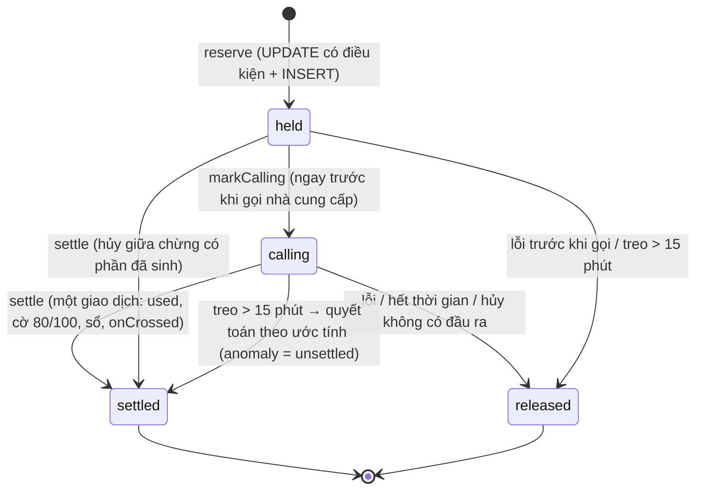

# Mô hình dữ liệu — Cổng AI thật

Schema PostgreSQL `ai_gateway` (đã khai trong `modules.manifest.json`). Tiền là `bigint` micro-USD (4 USD = 4 000 000). Thời gian
`timestamptz` UTC; ngày chu kỳ/tuần là `date`. Khóa chính UUID v7 sinh ở ứng dụng. Migration `0024` (bảng, ràng buộc, RLS, phân
vùng) và `0025` (cấu hình khởi đầu, khung nhìn hỗ trợ, quyền) — **chỉ thêm**, tương thích ngược (API/Worker cũ chạy song song).

## 1. Ánh xạ tên Việt → Anh (ghi vào bảng thuật ngữ kiến trúc khi ingest)

| Tài liệu / spec | Mã nguồn |
|---|---|
| ngân sách AI | `ai_budgets` (thực thể `ai_budget`) |
| giữ chỗ | `ai_reservations` (`ai_reservation`) |
| sổ chi phí AI | `ai_cost_ledger` |
| bảng giá mô hình | `model_prices` (`model_price`) |
| ngân sách hệ thống / giữ chỗ hệ thống / sổ hệ thống | `system_budgets` / `system_reservations` / `system_cost_ledger` |
| định tuyến mô hình | `model_routes` |
| dự phòng theo loại việc | `task_fallback` |
| cấu hình Cổng AI | `ai_settings` |
| hóa đơn nhà cung cấp (đối soát) | `provider_invoices` |
| phân bổ chi phí xu hướng | `ai_trend_allocations` |
| mã yêu cầu logic | `request_id` / `requestId` |
| mốc chu kỳ | `anchor_date` / `getAiCycleAnchor()` |
| chu kỳ / tuần | `cycle_start` / `week_start` |
| mức dùng cho khách | `AiUsage` (không đổi) |

## 2. Bảng tenant (`tenantTable`: `id`, `account_id` FK cascade, `created_at`, `updated_at`, RLS `tenant_isolation`)

### 2.1 `ai_budgets` — một dòng mỗi tài khoản mỗi chu kỳ (FR-002)

| Cột | Kiểu | Ghi chú |
|---|---|---|
| `cycle_start` | `date` NOT NULL | Ngày bắt đầu chu kỳ (R-05) |
| `cycle_end` | `date` NOT NULL | Ngày bắt đầu chu kỳ kế (dùng cho `nextCycleStartsAt`) |
| `used` | `bigint` NOT NULL DEFAULT 0 | Chi phí đã quyết toán (kẹp trần) |
| `reserved` | `bigint` NOT NULL DEFAULT 0 | Tổng giữ chỗ đang mở |
| `cap` | `bigint` NOT NULL | Trần cứng, chụp từ `ai_settings` lúc tạo (mặc định 4 000 000) |
| `soft_limit` | `bigint` NOT NULL | Ngưỡng mềm, chụp lúc tạo (mặc định 2 000 000) |
| `notified_80`, `notified_100` | `boolean` NOT NULL DEFAULT false | Cờ mốc, bật bằng cập nhật có điều kiện `= false` |

Ràng buộc: `UNIQUE (account_id, cycle_start)`; `CHECK (used >= 0 AND reserved >= 0 AND used + reserved <= cap)` **(chốt cuối III)**;
`CHECK (soft_limit < cap AND cap > 0)`. Chỉ mục `(account_id, cycle_start DESC)`.

Trạng thái hiển thị suy ra, không lưu: `normal` (`used+reserved < soft_limit`), `cheap_model` (≥ soft), `blocked`
(`cap - spent < minCallEstimate`). Tạo lười bằng `INSERT … ON CONFLICT DO NOTHING` (FR-014).

### 2.2 `ai_reservations` — một lần giữ chỗ cho một lời gọi (FR-008)

| Cột | Kiểu | Ghi chú |
|---|---|---|
| `cycle_start` | `date` NOT NULL | Khớp `ai_budgets` |
| `task` | `text` NOT NULL | `post_generation`, `topic_suggestion`, `image_labeling`, `video_labeling`, `transcription` |
| `model_tier` | `text` NOT NULL | `default`, `cheap`, `cheap_vision`, `stt` |
| `provider`, `model_id` | `text` NOT NULL | Lượt đang giữ (chính hoặc dự phòng) |
| `price_id` | `uuid` NOT NULL | Dòng `model_prices` đã dùng để ước tính (tham chiếu nội bộ module, có FK) |
| `estimate` | `bigint` NOT NULL CHECK ≥ 0 | Chi phí tối đa ước tính |
| `state` | `text` NOT NULL DEFAULT `'held'` | `held \| calling \| settled \| released` |
| `request_id` | `text` NULL | Mã yêu cầu logic (R-04), ≤ 128 ký tự |
| `trace_id` | `text` NULL | |
| `reserved_at`, `called_at`, `closed_at` | `timestamptz` | `called_at` đặt ở `held → calling` |

Chuyển trạng thái chỉ bằng `UPDATE … WHERE state = :expected` (hợp lệ: `held→calling`, `held|calling→settled`, `held|calling→released`).
Chỉ mục: `(account_id, state, reserved_at)` (dọn treo); **duy nhất từng phần** `(account_id, cycle_start, request_id) WHERE
request_id IS NOT NULL AND state <> 'released'` (FR-037a).

### 2.3 `ai_cost_ledger` — sổ chi phí chỉ-thêm, phân vùng theo tháng (FR-015, FR-016)

Định nghĩa Drizzle ở `ai-cost-ledger.log-table.ts` (khuôn `publish-steps`); DDL viết tay: `PARTITION BY RANGE (created_at)`, RLS
`tenant_isolation` (USING/WITH CHECK `account_id = account.current_account_id()`), quyền chỉ `INSERT`/`SELECT` cho `app`/`system`
(không `UPDATE`/`DELETE` — thu hồi). Việc định kỳ tạo trước phân vùng tháng và bỏ phân vùng > 12 tháng đã có ở kiến trúc (mục 6).

| Cột | Kiểu | Ghi chú |
|---|---|---|
| `id` (cùng `created_at` làm khóa phân vùng), `account_id` | uuid | Không FK (giữ sau khi xóa tài khoản, như `audit_log`) |
| `cycle_start` | `date` | |
| `reservation_id` | `uuid` | Tham chiếu nội bộ (không FK vì bảng phân vùng) |
| `request_id` | `text` NULL | Bản sao để tra/đối soát |
| `task`, `model_tier`, `model_id`, `provider` | `text` | |
| `input_tokens`, `output_tokens`, `cached_input_tokens` | `integer` | `0` cho STT |
| `audio_seconds` | `integer` NULL | Chỉ STT (đơn vị tính theo phút âm thanh) |
| `cost_micro_usd` | `bigint` | Chi phí **thực**, không kẹp (với `unsettled` = ước tính) |
| `estimate_micro_usd` | `bigint` | |
| `anomaly` | `text` NULL | `over_estimate \| unsettled \| missing_usage` |
| `over_cap_micro_usd` | `bigint` DEFAULT 0 | Phần bị kẹp vì vượt trần |
| `trace_id` | `text` | |
| `created_at` | `timestamptz` | |

Bất biến đối soát (SC-006): với mỗi `(account_id, cycle_start)`, `used = Σ(cost_micro_usd) − Σ(over_cap_micro_usd)` (sai lệch 0).
`anomaly = 'missing_usage'` khi nhà cung cấp không trả token thực (Edge Case): quyết toán theo ước tính, token = 0, cảnh báo.

### 2.4 `ai_trend_allocations` — phần chi phí xu hướng chia cho tài khoản cùng ngành (FR-033)

`week_start date`, `industry_id uuid` (mã tham chiếu, **không FK**, ADR-09), `cost_micro_usd bigint`, `shared_ledger_id uuid`
(dòng `system_cost_ledger` nguồn). `UNIQUE (account_id, week_start, industry_id, shared_ledger_id)`. Chỉ đọc bởi nhân viên qua khung
nhìn hỗ trợ; **không** cộng vào `ai_budgets.used`. Khách không thấy.

## 3. Bảng hệ thống (`sharedTable`, có `reason`; chỉ vai trò `system` ghi)

### 3.1 `system_budgets`, `system_reservations`, `system_cost_ledger`

Như 005 (`ai_fake_system_*`) với thay đổi: `system_budgets.week_start` PK (thứ Hai 00:00 UTC+7), `cap` **chụp lúc tạo** theo R-11
(`industry_count × per_industry_weekly_micro_usd`, hoặc trần cấu hình tạm), thêm `industry_count int`, `per_industry_micro_usd bigint`
để truy vết; `CHECK (used + reserved <= cap)`. `system_reservations` thêm `provider`, `model_id`, `price_id`, `request_id`;
`system_cost_ledger` thêm `industry_id uuid`, các cột sổ như 2.3 (không phân vùng ở giai đoạn 1: khối lượng ~1 lời gọi/ngành/tuần).

### 3.2 `model_prices` — chỉ-thêm (FR-019, FR-020)

| Cột | Kiểu | Ghi chú |
|---|---|---|
| `id` | uuid | |
| `provider`, `model_id` | `text` | Định danh mô hình thật |
| `unit` | `text` | `token \| audio_minute` |
| `input_per_mtok`, `output_per_mtok`, `cached_input_per_mtok` | `bigint` NULL | micro-USD / 1 000 000 token (bắt buộc khi `unit='token'`) |
| `per_minute` | `bigint` NULL | micro-USD / phút âm thanh (bắt buộc khi `unit='audio_minute'`) |
| `billing_granularity_sec` | `int` DEFAULT 1 | Làm tròn lên theo nhà cung cấp (1 hoặc 60) |
| `effective_from` | `timestamptz` | Phải ≥ `now() + TTL đệm` khi thêm (R-06) |
| `created_by` | `text` | Mã nhân viên |
| `created_at` | `timestamptz` | |

`CHECK` mọi giá `> 0` và khớp `unit`. Trigger chặn `UPDATE`/`DELETE` (chỉ thêm). Chỉ mục `(provider, model_id, unit, effective_from DESC)`.
Kiểm tra lệch 10× nằm ở dịch vụ quản trị (cần dòng hiện hành); `CHECK > 0` là chốt cuối.

### 3.3 `model_routes` và `task_fallback` — định tuyến + dự phòng theo loại việc (FR-024a)

- `model_routes(tier text, rank smallint CHECK IN (1,2), provider text, model_id text, enabled boolean, updated_at, updated_by)`,
  `PRIMARY KEY (tier, rank)`. Thiếu `rank = 1` cho một bậc → lời gọi bậc đó bị từ chối trước khi gọi (cấu hình thiếu).
- `task_fallback(task text PRIMARY KEY, enabled boolean NOT NULL DEFAULT false, updated_at, updated_by)` — 6 dòng, khởi đầu: chỉ
  `post_generation`, `topic_suggestion` bật; còn lại tắt (SA đổi được).

### 3.4 `ai_settings` — một dòng (FR-011, FR-019a, FR-032a)

`id smallint PRIMARY KEY CHECK (id = 1)`, `account_cap_micro_usd bigint` (4 000 000), `account_soft_limit_micro_usd bigint`
(2 000 000), `per_industry_weekly_micro_usd bigint`, `updated_at`, `updated_by`; `CHECK (soft < cap AND per_industry_weekly > 0)`.

### 3.5 `provider_invoices` — dữ liệu đối soát do vận hành nhập (FR-034)

`provider text`, `invoice_date date`, `total_micro_usd bigint CHECK >= 0`, `entered_by text`, `entered_at timestamptz`,
`UNIQUE (provider, invoice_date)` (nhập lại = thay có kiểm toán, không sửa lặng lẽ).

## 4. Ghi chú liên module và dữ liệu cá nhân

- Không khóa ngoại sang module khác; `account_id` → `accounts` (cascade) theo ADR-09; `industry_id` là mã tham chiếu.
- Dữ liệu cá nhân: **không có**. Sổ chỉ có số liệu và mã; không lưu lời nhắc, văn bản kết quả hay email. `trace_id` không phải dữ
  liệu cá nhân. Bên nhận ở nước ngoài (nhà cung cấp AI) ghi vào danh sách chuyển dữ liệu xuyên biên giới (R-17).
- Xóa tài khoản: `ai_budgets`, `ai_reservations`, `ai_trend_allocations` xóa theo cascade; `ai_cost_ledger` (không FK, đã chỉ có số liệu) giữ
  đến hết phân vùng 12 tháng, không chứa dữ liệu cá nhân (hiến pháp VII).

## 5. Quan hệ và trạng thái

`ai_budgets` (1) ← (n) `ai_reservations` (theo `cycle_start`); `ai_reservations` (1) ← (≤ 1) `ai_cost_ledger`; `model_prices` (1) ← (n)
`ai_reservations.price_id`; `model_routes`/`task_fallback` chỉ đọc ở đường gọi.
